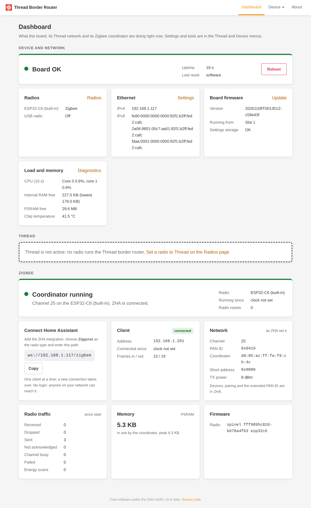
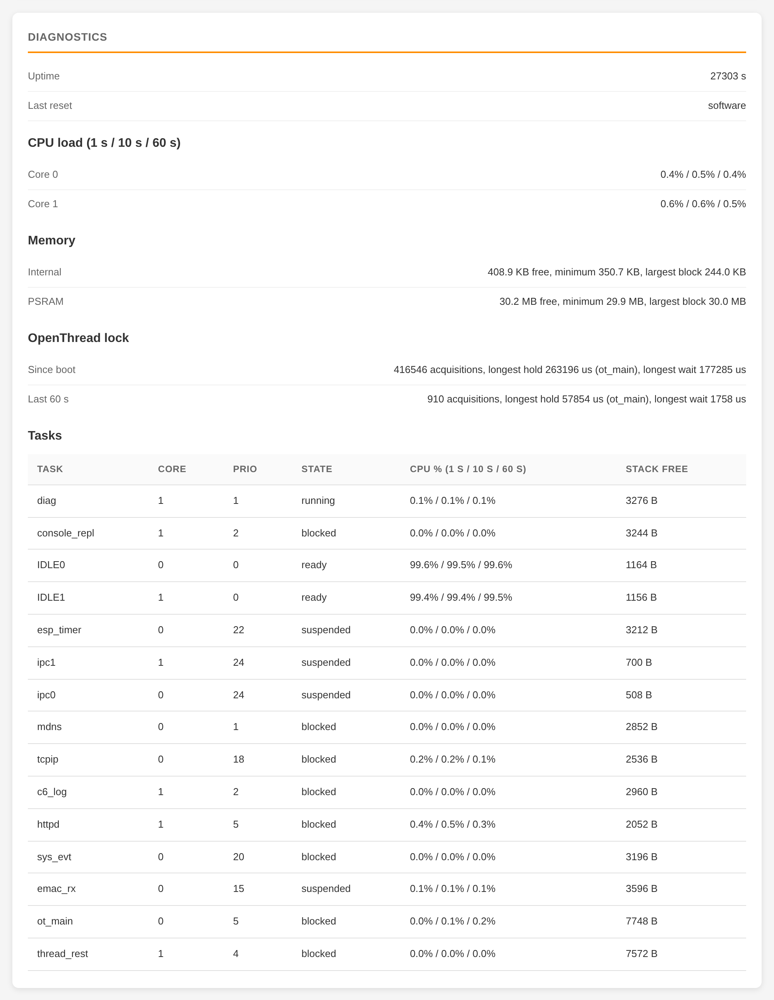
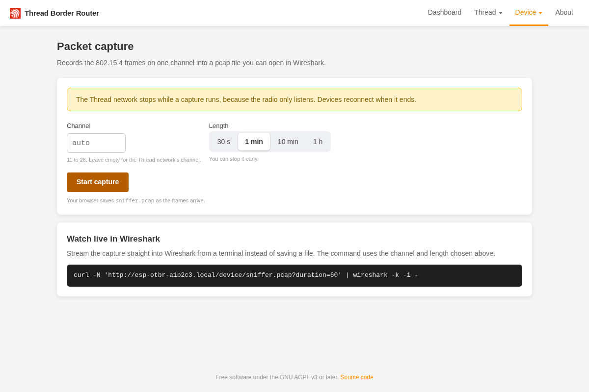

# ESP32-P4 OpenThread Border Router

**A full-featured Thread border router on one PoE board, for under $30.**

This firmware turns the Waveshare ESP32-P4-WIFI6-POE-ETH into an OpenThread Border Router. The ESP32-P4 runs the
border router, the ESP32-C6 on the same board is the 802.15.4 radio, and the board sits on your network over wired
Ethernet. You don't need a Raspberry Pi, USB dongles or Wi-Fi, and it can be powered over PoE.

Plug a radio dongle into its USB port and the same board becomes a small radio hub: Thread on either radio, a Zigbee
coordinator for ZHA (experimental), or a radio served to another host over the network, each switched from the
browser.

Get the board from [Waveshare](https://www.waveshare.com/esp32-p4-wifi6-poe-eth.htm),
[AliExpress](https://a.aliexpress.com/_Ev2qYJC) or [Amazon](https://a.co/d/0hmmgSAF).

## Why

- **Works with Home Assistant.** It speaks the Thread REST API that Home Assistant's OpenThread Border Router
  integration uses: point it at `http://<board>` and it forms or imports the network.
- **Wired and always on.** It uses Ethernet with IPv4 and IPv6, DHCPv6 prefix delegation, NAT64 and mDNS/SRP service
  advertising. One cable carries power and data.
- **Every radio is a channel.** The on-board C6 and a USB dongle (cp210x, CH34x or CDC-ACM bridges; checked with the
  ZigStar OllyZig) each run in a mode you pick on the Radios page: `otbr`, `ziggurat` (Zigbee), `rcp-proxy` or `off`.
  The board detects the dongle's firmware when you plug it in (OpenThread RCP, Ziggurat, Z-Stack, EZSP) within 3 s and
  refuses a mode the firmware can't run. [Radios](docs/radios.md)
- **Moves Thread between radios live.** Put the border router on the C6 or on a dongle: it moves at runtime with the
  stored network, without a reboot. Unplug its dongle and the board stays up and waits; plug it back and Thread starts
  again.
- **Zigbee coordinator (experimental).** A radio in Zigbee mode runs the Ziggurat stack on the P4 and serves Home
  Assistant's ZHA over a WebSocket (`ws://<board>/zigbee`), with its own section on the Dashboard and metrics in
  `/metrics`. [Zigbee](docs/zigbee.md)
- **Shares a radio over the network.** In `rcp-proxy` mode a channel's bytes go to one peer over TCP or UDP, listening
  or dialling out, so an OpenThread or Zigbee host elsewhere can use the board's radio.
- **Updates itself from GitHub.** One click on the Firmware page checks the latest release and installs it: the
  firmware and the web UI together with automatic rollback, then the radio firmware if it changed, then one reboot.
  You can still upload images from the browser. [Updates](docs/updates.md)
- **Radio firmware updates without a reboot.** A push to the C6 restarts whatever runs on it (Thread, Zigbee or the
  proxy) on the new firmware and only answers once it runs again, or says why it didn't.
- **Routes the mesh without prefix delegation.** No DHCPv6-PD from your ISP or router? Pick your own OMR prefix (a GUA
  /64 from your space, or the self-generated ULA) and announce it to your core router over **BGP** (iBGP or eBGP, up to
  2 peers) or **RIPng**, so hosts on other subnets reach Thread devices. Set live on the Routing page, no reboot.
- **Joins border routers over Ethernet.** TREL (Thread over Ethernet) links border routers of the same Thread network
  over Ethernet, so radio islands in different rooms or floors become one mesh and traffic can route around weak radio
  hops. Works with any TREL-capable border router on the same Ethernet link (the Thread backbone VLAN in split mode). On
  by default, switched live on the Ethernet page.
- **Built for your network.** An optional VLAN split mode puts management and the Thread backbone on separate VLANs,
  and confirm-or-revert means a bad network setting can't lock you out.
- **Sees what is on the air.** Sniffer mode streams 802.15.4 traffic as pcap straight into Wireshark, and the Thread
  Console runs OpenThread CLI commands on the board from the browser.
- **Fixes its own radio.** With three optional jumper wires, the board repairs the C6 radio by itself and captures its
  console.
- **Shows what it is doing.** The device pages and `/device/diag` report CPU load per core and task, memory, chip
  temperature and OpenThread lock timings, and `/metrics` exports them with the Thread and Zigbee figures to
  Prometheus.

## Compared with the usual setups

Most Home Assistant installs run Thread with the OpenThread Border Router add-on and a radio in RCP mode: either a USB
dongle on the Home Assistant host, or a network-attached radio the add-on reaches over TCP. This board runs the whole
border router itself, so you can put several on the same Thread network for coverage and redundancy: if one goes
down, the others keep the network reachable.

| | This board | Add-on with a USB radio | Add-on with a network radio |
| --- | --- | --- | --- |
| Border routers on one Thread network | ✅ as many as you like: add a board for each spot that needs coverage | ❌ one, since the add-on runs once per Home Assistant host | ❌ one, since the add-on runs once per Home Assistant host |
| Border router keeps running when the Home Assistant host reboots or the add-on updates | ✅ yes | ❌ no | ❌ no |
| Network setup | ✅ its own, on any VLAN; split mode keeps management and the Thread backbone on separate VLANs | ❌ the Home Assistant host's; another VLAN means reconfiguring the host | ❌ the Home Assistant host's; another VLAN means reconfiguring the host |
| Radio placement | ✅ anywhere with Ethernet | ❌ at the Home Assistant host, on a USB extension cable | ✅ anywhere with Ethernet |
| Routing to the mesh without DHCPv6-PD | ✅ custom OMR prefix announced over BGP or RIPng | ❌ PD, or a static route on your router | ❌ PD, or a static route on your router |
| Link between border router and radio | ✅ on-board SPI | ✅ USB serial (passthrough needed in a VM) | ❌ spinel over TCP, sensitive to network delay |
| Second radio | ✅ a USB dongle for Thread, Zigbee (experimental) or a network RCP proxy; Thread moves between radios live | ❌ one radio per add-on | ❌ one radio per add-on |
| Packet capture, radio recovery, diagnostics | ✅ built in | ❌ separate tools | ❌ separate tools |
| Runs without a Home Assistant host | ✅ yes | ❌ no | ❌ no |

## Screenshots

<table>
  <tr>
    <td width="25%"></td>
    <td width="25%"></td>
    <td width="25%"></td>
    <td width="25%"></td>
  </tr>
  <tr>
    <td align="center">Dashboard</td>
    <td align="center">Thread mesh topology</td>
    <td align="center">Live diagnostics</td>
    <td align="center">Packet capture</td>
  </tr>
</table>

## Get started

You need [the board](https://www.waveshare.com/esp32-p4-wifi6-poe-eth.htm), a 2.4 GHz antenna on the C6 antenna connector, a USB-C cable for the first flash, and Ethernet.

1. Download `p4-flash.zip`, `c6_installer.bin` and `c6_rcp.bin` from the
   [latest release](https://github.com/t3hk0d3/esp32-p4-otbr/releases), or build them yourself with `make build`. Take
   all three from the same release or build: the installer must match the P4 firmware.
2. Flash the P4 over USB-C: in Chrome or Edge with the [browser flasher](https://t3hk0d3.github.io/esp32-p4-otbr/flash/)
   (no download needed), or unpack `p4-flash.zip` and run `esptool --chip esp32p4 write-flash @flash_args` in it, or run
   `make flash` from a checkout.
3. A new board's C6 still runs its factory firmware (Espressif ESP-Hosted). Upload `c6_installer.bin` once on the
   Firmware page at `http://<board>/firmware.html`: the P4 sends it through ESP-Hosted's own update, and it installs
   what the radio updates need. Skip this step if the maintenance jumper is fitted (the P4 then replaces the factory
   firmware by itself) or if the C6 already runs this project's firmware.
4. Upload the radio firmware `c6_rcp.bin` on the same page.
5. Add the board to Home Assistant ([how](docs/home-assistant.md)), or form a network in its web UI.

[First install](docs/first-install.md) walks through all three ways to bring up a new board: no wires, the maintenance
jumper, or a USB-UART adapter on the C6 header.

## Documentation

**Read it online at [t3hk0d3.github.io/esp32-p4-otbr](https://t3hk0d3.github.io/esp32-p4-otbr/).**

The same pages are in [`docs/`](docs/README.md): [Home Assistant](docs/home-assistant.md), [building](docs/building.md),
[updates](docs/updates.md), [API and web UI](docs/api.md), [radios and USB dongles](docs/radios.md),
[Zigbee coordinator](docs/zigbee.md), [networking, VLANs, TREL and mesh routing](docs/networking.md),
[sniffer](docs/sniffer.md), [maintenance jumper](docs/maintenance-jumper.md), [diagnostics](docs/diagnostics.md),
[Prometheus metrics](docs/metrics.md), [troubleshooting and limitations](docs/troubleshooting.md) and
[development](docs/development.md). Run `make help` to list the targets for building, flashing, updating and testing.

> There is no authentication: anyone on the network can reconfigure or update the board. Put it on a trusted network.

## License

Copyright (C) 2026 Igor Yamolov. This project is free software under the
[GNU Affero General Public License v3.0 or later](LICENSE), with an extra permission to link Espressif's binary-only
radio libraries (see [`NOTICE`](NOTICE)). If you run a modified version that other people use over the network, you
must offer them its source code. The vendored esp-thread-br components stay under Apache-2.0. See
[`CHANGELOG.md`](CHANGELOG.md) for what changed in each release.
