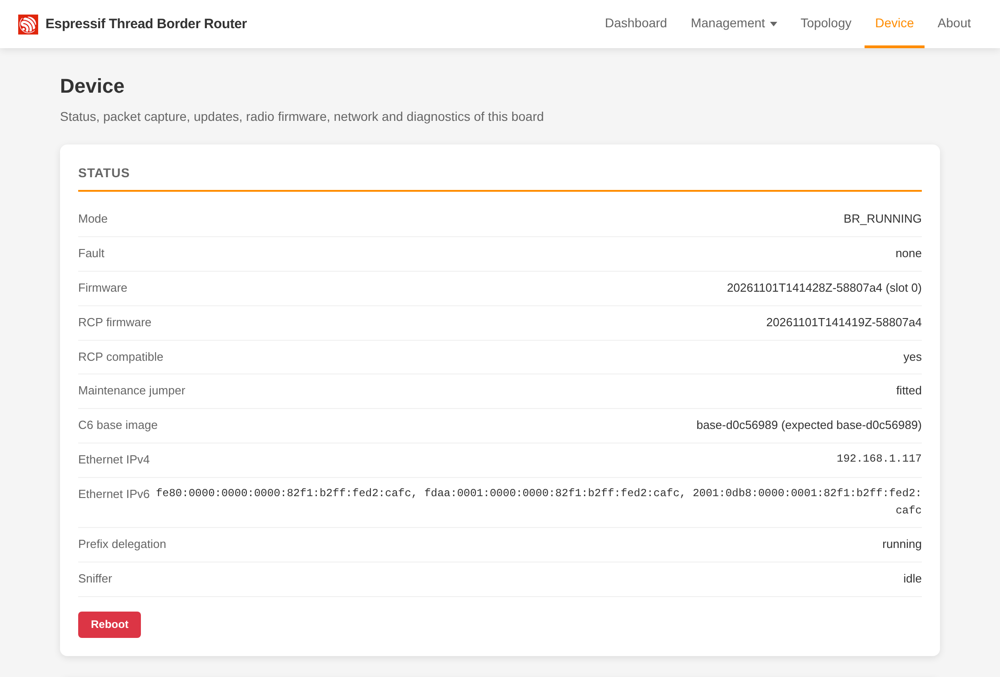
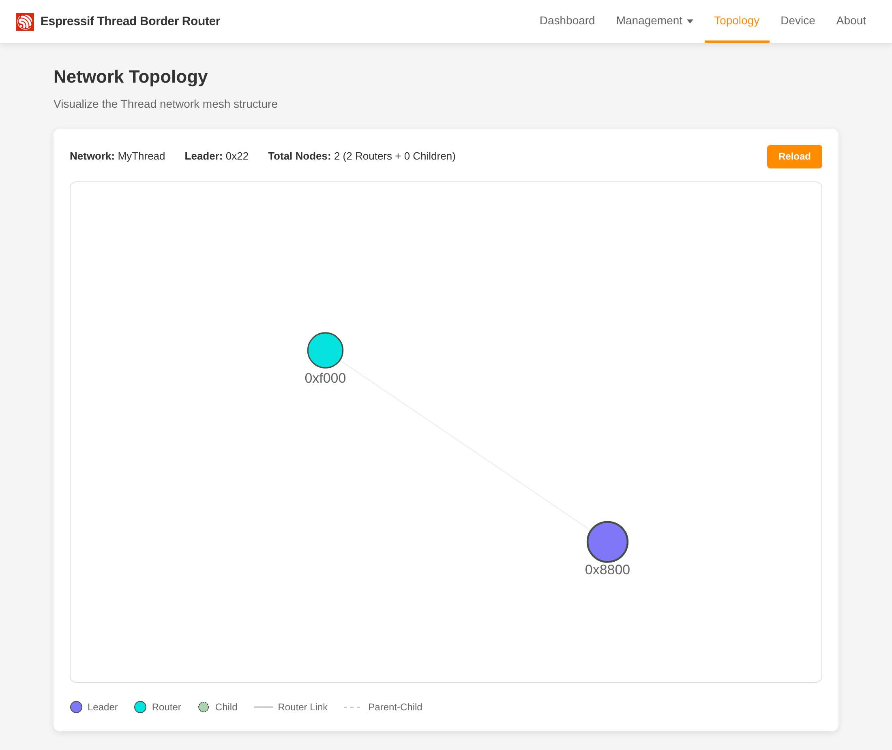

# ESP32-P4 OpenThread Border Router

**A standalone Thread border router for Home Assistant, on a single PoE board.**

This firmware turns the Waveshare ESP32-P4-WIFI6-POE-ETH into an OpenThread Border Router. The ESP32-P4 runs the
border router, the ESP32-C6 on the same board is the 802.15.4 radio, and the board sits on your network over wired
Ethernet. You don't need a Raspberry Pi, USB dongles or Wi-Fi, and it can be powered over PoE.

## Why

- **Works with Home Assistant.** It speaks the Thread REST API that Home Assistant's OpenThread Border Router
  integration uses: point it at `http://<board>` and it forms or imports the network.
- **Wired and always on.** It uses Ethernet with IPv4 and IPv6, DHCPv6 prefix delegation, NAT64 and mDNS/SRP service
  advertising. One cable carries power and data.
- **Updates over the network.** The firmware and the web UI update together with automatic rollback, and the radio
  firmware updates separately, all from the browser.
- **Built for your network.** An optional VLAN split mode puts management and the Thread backbone on separate VLANs,
  and confirm-or-revert means a bad network setting can't lock you out.
- **Sees what is on the air.** Sniffer mode streams 802.15.4 traffic as pcap straight into Wireshark.
- **Fixes its own radio.** With three optional jumper wires, the board repairs the C6 radio by itself and captures its
  console.
- **Shows what it is doing.** A device page and `/device/diag` report CPU load per core and task, memory and
  OpenThread lock timings.

## Screenshots

<table>
  <tr>
    <td width="50%"></td>
    <td width="50%"></td>
  </tr>
  <tr>
    <td align="center">Thread mesh topology</td>
    <td align="center">Live diagnostics</td>
  </tr>
</table>

## Get started

You need the board, a 2.4 GHz antenna on the C6 antenna connector, a USB-C cable for the first flash, and Ethernet.

1. Download `p4-flash.zip` and `c6_rcp.bin` from the [latest release](https://github.com/t3hk0d3/esp32-p4-otbr/releases),
   or build them yourself with `make build`.
2. Flash the P4 over USB-C: unpack `p4-flash.zip` and run `esptool --chip esp32p4 write-flash @flash_args` in it, or
   run `make flash` from a checkout.
3. Upload the radio firmware on the device page at `http://<board>/device.html`.
4. Add the board to Home Assistant, or form a network in its web UI.

A new board's C6 still has its factory firmware. With the maintenance jumper fitted, the P4 replaces it by itself;
without the jumper, you write it once over a USB-UART adapter. [First install](docs/first-install.md) walks through both
paths.

## Documentation

Everything is in [`docs/`](docs/README.md): [building](docs/building.md), [updates](docs/updates.md),
[API and web UI](docs/api.md), [networking and VLANs](docs/networking.md), [sniffer](docs/sniffer.md),
[maintenance jumper](docs/maintenance-jumper.md), [diagnostics](docs/diagnostics.md),
[troubleshooting and limitations](docs/troubleshooting.md) and [development](docs/development.md). Run `make help`
to list the targets for building, flashing, updating and testing.

> There is no authentication: anyone on the network can reconfigure or update the board. Put it on a trusted network.

## License

Copyright (C) 2026 Igor Yamolov. This project is free software under the
[GNU Affero General Public License v3.0 or later](LICENSE), with an extra permission to link Espressif's binary-only
radio libraries (see [`NOTICE`](NOTICE)). If you run a modified version that other people use over the network, you
must offer them its source code. The vendored esp-thread-br components stay under Apache-2.0. See
[`CHANGELOG.md`](CHANGELOG.md) for what changed in each release.
