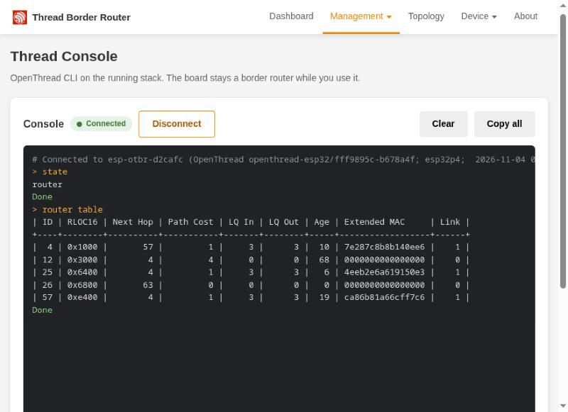
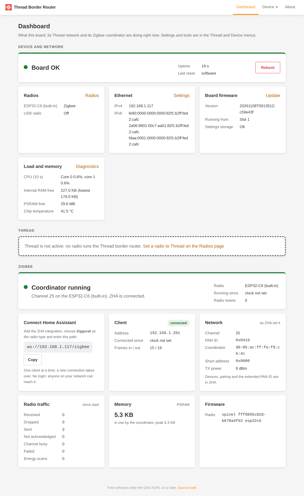
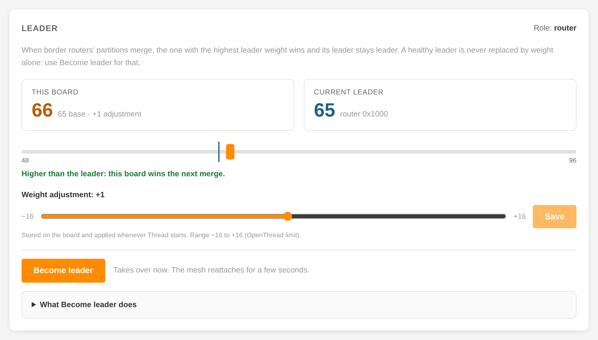
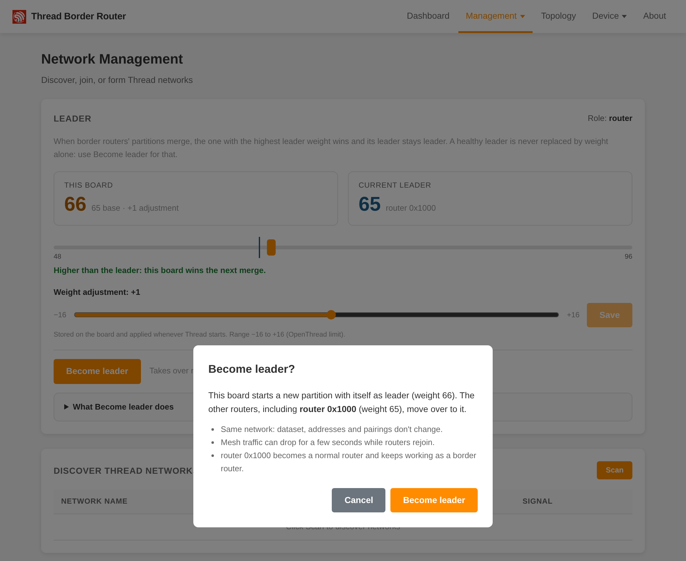

# HTTP API and web UI

Everything is on port 80, no authentication. Errors on `/device/*` are JSON `{"error": "<code>", "detail": "<text>"}`. Besides the errors listed
below, any of them can answer 500 `internal` or `no_memory`.

## Device API

| Method and path | Purpose | Notable errors |
| --- | --- | --- |
| `GET /device/status` | mode, app version and slot, `rcp`, `jumper`, `eth` addresses, `pd`, `routing`, `sniffer` stats, `fault_reason`, `storage_ok`, `trel` (`enabled`, `active`, `peers` (this Thread network), `peers_other` (other networks), `tx_packets`, `tx_failures`, `rx_packets`, `peer_list`: at most 8, this network's first, each `ext_address`, `ext_pan_id`, `same_network`, `preference` (`{"ieee802154": 0..255\|null, "trel": 0..255\|null}`, OpenThread's per-radio preference; `null` when the peer is not a Thread neighbour), `address`; `trel` is `null` in a build without TREL; `active`, both counts and the counters `null` when OpenThread's state could not be read) | |
| `GET /device/sniffer.pcap?channel=&duration=` | stream a pcap capture | 400 `invalid_channel`, `invalid_duration`, `no_channel`; 409 `busy` (not `BR_RUNNING`); 503 `busy` (no channel given and OpenThread's state could not be read within 100 ms: retry); 500 `sniffer_failed` |
| `DELETE /device/sniffer` | stop the running capture | 404 `not_found` |
| `GET /device/update[?check=true\|false]` | the cached state of the update check against the latest GitHub release; never waits for the network. `check=true` starts a check on a worker (the reply shows `state: "checking"`; a running check is joined) and the caller polls the plain `GET`. Fields: `state` (`never`, `checking`, `done`, `failed`), `checked_age_s` (seconds since the last finished check, `null` before the first), `error` (detail of the last failed check, else `null`), `release` (`null` until a check succeeded, then kept: `{"tag": <string>\|null, "app", "rcp": <string>\|null, "url": <release page>}`; `tag` and `rcp` are `null` when `versions.txt` has no such line), `repo_url`, `running` (`{"app", "rcp"}`; `rcp` `null` when unknown), `app` (`newer`, `same`, `older`, `unknown`; `null` without a release), `rcp_differs`, `available` (`app` is `newer` or `unknown`, or `rcp_differs`). See [Updates](updates.md) | 400 `invalid_request` (`check` is not `true` or `false`); 409 `busy` (`check=true` while OTA, a radio push or ROM recovery runs) |
| `POST /device/update[?force=1\|0]` | check again (the cached result is not used), then install the latest release: the bundle, then the radio firmware when it differs, then one reboot. The body is empty and the request is held until the install ends. 200 `{"status":"ok","app":"installed"\|"unchanged","rcp":"installed"\|"unchanged"\|"failed","detail":...,"rebooting":bool}`; `rcp` `failed` means the new app is committed and the board reboots, and the next update pushes only the radio firmware. `force=1` installs although nothing is newer | 400 `invalid_request` (a body, or `force` not `0` or `1`), `invalid_bundle`; 409 `up_to_date` (nothing to install, no `force`), `busy` (another long operation or a check runs; the radio firmware is to be installed and the board is sniffing or starting); 502 `check_failed` (`versions.txt` could not be fetched or read; nothing changed), `transfer_failed` (bundle download; nothing changed), radio-only update: the errors of `POST /device/radio/firmware?from_url=` |
| `POST /device/ota` | upload an `otbr.bundle`, then reboot | 400 `length_required`, `invalid_bundle`; 413 `payload_too_large`; 409 `busy` |
| `POST /device/ota/url` | body `{"url": "http(s)://..."}`, same via download (https is checked against the built-in certificate bundle; only 301, 302 and 307 redirects are followed) | 400 `invalid_request`, `invalid_bundle`; 409 `busy`; 502 `transfer_failed` |
| `POST /device/radio/firmware[?from_url=]` | (`from_url` is an `http://` or `https://` address; redirects are followed) push `c6_rcp.bin` to the C6, restart the BR; on a factory C6 (`fault_reason` `esp-hosted firmware`) only a `c6_installer.bin` with this firmware's C6 base version, sent through ESP-Hosted, then `{"installed":null}` and `no rcp firmware` | 400 `length_required`, `invalid_image` (also `c6_installer.bin` to our updater, anything else to ESP-Hosted, an installer with another base version), `image_too_large`; 413 `payload_too_large`; 409 `busy` (sniffing, starting, update running); 502 `fetch_failed`, `push_failed`, `install_failed` (ESP-Hosted transfer of `c6_installer.bin`), `restart_failed` (the image is installed, but OpenThread did not start on it; the detail names the fault) |
| `POST /device/radio/recover` | maintenance jumper: rewrite the C6 base image (no RCP firmware) and restart | 200 `{"recovered":true,"rcp":"<installed version>"\|"no rcp firmware"\|"unknown","mode":...}` (also when the C6 has no RCP firmware afterwards); 412 `no_jumper`; 409 `busy`; 502 `recovery_failed` (only when the recovery itself failed) |
| `GET /device/radio/log` | jumper: the newest 16 KB of the C6 console (`text/plain`) | 412 `no_jumper` |
| `GET /device/diag` | per-core load, per-task CPU/stack/affinity, memory, OpenThread lock stats, uptime, reset reason, chip temperature (`chip_temperature_c`, die temperature in °C with one decimal, `null` when unavailable) | |
| `GET /device/network` | active config (with `trel`), pending trial with remaining time, interface state | |
| `PUT /device/network` | store a trial network config and reboot into it; a body that changes only `trel` is applied at once without a trial (`{"status":"applied"}`; `{"status":"saved","detail":...}` when Thread is not running or busy and it applies at the next start; see [TREL](networking.md#trel-thread-over-ethernet)) | 400 `invalid_config` (`detail` names the field, `trel` when not a boolean), `length_required`, `invalid_request`; 409 `busy` (also a `trel`-only change while a trial runs); 413 `payload_too_large`; 503 `not_started`; 500 `store_failed` |
| `POST /device/network/confirm` | commit the trial config | 409 `no_trial`; 403 `wrong_interface`; 500 `store_failed` |
| `GET /device/names` | network names: `hostname`, `hostname_default`, `hostname_live` (differs after an mDNS conflict rename), `ha_name_follows_hostname`, `ha_name`, `ha_name_effective`, `http_advert`, `http_advert_available` (false in split mode), `dhcp_name`, `dhcp_name_default`, `mode` | |
| `PUT /device/names` | body `{hostname, ha_name_follows_hostname, ha_name, http_advert, dhcp_name}` (all required; empty hostname / DHCP name = default); applied live, no reboot; replies the GET body plus `applied` and, when a live step failed, `detail` | 400 `invalid_config` with `field` (`hostname`, `ha_name`, `dhcp_name`, or a missing / wrongly typed key, `body` for no JSON object), `length_required`, `invalid_request`; 413 `payload_too_large`; 500 `storage_failed` |
| `GET /device/thread` | leader weight: `leader_weight_adjustment` (stored, -16..16), `leader_weight` (this board's local weight) and `leader_weight_base` (weight minus adjustment); only the adjustment while OpenThread is not running, plus `partial: true` when its lock was not free in time | |
| `PUT /device/thread` | body `{leader_weight_adjustment?, become_leader?}` (at least one; `8.0` counts as 8; `become_leader: false` does nothing). Order: validate the whole body, store and apply the adjustment, then take over as leader (only from a strictly lower weight; never automatic). Replies the GET body plus `applied` (and `detail` when false: `Thread is not running` or `OpenThread is busy, applied within seconds or at the next start`) and `"become_leader":"started"` (`"partial": true` can follow a started take-over when the weight read times out) | 400 `invalid_config` with `field` (`leader_weight_adjustment`, `become_leader`, `body`), `length_required`, `invalid_request`; 409 `cannot_take_over` with `detail` `weight not higher` / `already leader` / `not attached` / `not router eligible` (an adjustment sent in the same body stays stored); 409 `busy` (`mode <MODE>`); 413 `payload_too_large`; 500 `storage_failed`, `internal` (`taking over failed`); 503 `busy` (`OpenThread is busy, retry` or `OpenThread is restarting, retry`). When the body also had an adjustment, a 409/503/500 from the take-over step also carries `leader_weight_adjustment` (the stored value) and `applied` |
| `POST /device/topology` | start a mesh scan (or join the running one); 202 with the state object | 409 `busy` (`mode <MODE>`, an update or radio job running, `a capture stream is already running` while a capture stream holds the pcap slot, `mesh diagnostics are in use`); 503 `busy` (`OpenThread is busy, retry`, or `topology scan unavailable` when the scan component failed to start at boot); 500 `no_memory` |
| `GET /device/topology` | the scan state, progress and the last result (no mesh traffic); in a build with TREL, a link of this board's router carries `transport` when OpenThread knows that neighbour's radios: `{"ieee802154": 0..255\|null, "trel": 0..255\|null}` (OpenThread's preference per radio, `null` for a radio it does not use); no `transport` on this board's link means its radios are unknown, and other routers' links never have it; the result carries service records from every SRP server, see [Service records](#service-records-in-the-topology-scan) | |
| `GET /device/routing` | routing settings and status, see [Routing](#routing) | 503 `not_started` |
| `PUT /device/routing` | store the routing settings and apply them live (no reboot) | 400 `invalid_request` (`detail` names the field), `length_required`; 413 `payload_too_large` (over 2048 bytes); 500 `storage_failed` (nothing changed), `internal` (the body could not be checked, `detail` is the error; nothing changed), `no_memory` (the settings were stored and applied, the answer could not be built); 503 `not_started` |
| `GET /device/console` | Thread console setting and session: `{"enabled": bool, "session": null \| {"peer": "<address>", "since_s": <s>}}`, see [Thread console](#thread-console) | |
| `PUT /device/console` | body `{"enabled": bool}`; stored, off by default; turning it off closes the session (4003); replies like GET | 400 `invalid_request` (`enabled` missing or not a boolean), `length_required`; 413 `payload_too_large`; 500 `storage_failed`; 503 `not_started` (the console did not start at boot) |
| `GET /device/console/ws` | WebSocket: the board's OpenThread CLI, see [Thread console](#thread-console) | 403 on an interface that does not serve the device API |
| `POST /device/reboot` | reboot | 409 `busy` while an update or push runs (other reboots, such as the network trial revert, `net reset` and `DELETE /node`, wait until it ends) |
| `GET /metrics` | device health and Thread figures in the Prometheus text format, see [metrics](metrics.md) | 500 `no_memory` |

`/device/status` modes: `STARTING`, `BR_RUNNING`, `SNIFFER`, `RADIO_FAULT`.

### Service records in the topology scan

The scan result lists the hosts and services registered with the network's SRP servers (`srp_hosts`) and says which
servers were asked (`srp_servers`). The SRP step runs next to the router and child phases from the start of the scan,
with its own 15 s budget inside the 60 s cap.

- Where records come from: this board's SRP server is read locally (with lease and key lease). Every other DNS/SRP
  server in the network data is asked over DNS-SD on port 53 for `_matter._tcp`, `_matterc._udp`, `_esphomelib._tcp`,
  `_hap._udp`, `_http._tcp`, `_meshcop._udp` and `_trel._udp`. An instance the browse answer did not describe (SRV,
  TXT and an address) is resolved for port, host address and TXT (with a follow-up AAAA query when the SRV answer has
  no address), unless the browse answer gave addresses and none passes the filter below; ESPHome and HomeKit resolves
  go first. At most 4 queries are in flight, 2 per server while several are asked; a server whose query times out
  before it answered anything is not asked again. A record whose TXT cannot be parsed is kept without TXT.
- Filter: a host is kept when it has an address under an OMR prefix or the mesh-local prefix. A border router record
  (`_meshcop._udp`, `_trel._udp`) is kept when its extended PAN ID (`xp`) is this network's and it has an extended
  address (`xa`) other than this board's.
- De-duplication: by host name; a host seen on several servers is listed once.
- Limits: 64 hosts, 8 services per host, 512 TXT bytes per service (`txt_truncated` is set when cut), 6 subtypes per
  service, 48 resolves per scan (16 of them kept for `_esphomelib._tcp` and `_hap._udp`), 15 s.
- A server that does not answer never sets `partial`. `srp_servers[].state` is `answered` (at least one query was
  answered, an empty answer counts, and all its queries ended), `no_answer` (no query it was asked got an answer:
  they all timed out or failed, or it was given up after a timeout), or `cut_short` (the budget or the cap ended the
  step while it still had queries in flight or waiting and had not been given up, or it answered only after its
  waiting queries were dropped).

```json
"srp_servers": [
  {"rloc16": 26624, "address": "fd8f:...:a75c", "port": 53536, "this_board": true, "state": "answered", "hosts": 1},
  {"rloc16": 4096, "address": "fd8f:...:bff7", "port": 53554, "this_board": false, "state": "answered", "hosts": 2}
],
"srp_hosts": [{
  "name": "c6-thread-test", "addresses": ["fd87:9b49:8264:1:c158:979b:6560:a15f"],
  "source": 26624, "lease_s": 7012, "key_lease_s": 1209412,
  "services": [{
    "instance": "c6-thread-test", "type": "_esphomelib._tcp", "port": 6053, "source": 26624,
    "subtypes": [], "txt": "<base64 of the TXT RDATA>", "txt_truncated": false
  }]
}]
```

- `srp_servers[]`: `rloc16` (number) of the server router, its `address`, the SRP `port` from the network data (the
  DNS query goes to port 53), `this_board`, `state`, and `hosts`, the hosts kept from it (after the address filter,
  before de-duplication).
- `srp_hosts[].source` and `services[].source`: the `rloc16` of the server the record came from. `lease_s` and
  `key_lease_s` only for hosts from this board's server; hosts from other servers have `ttl_s` instead.
- `services[].port` is the SRV port. `txt` is the base64 of the raw TXT RDATA, `""` when the record has none.
  `subtypes` is always empty for hosts from other servers.

### Device info in the topology scan

After the router and child tables, the scan asks every router and every child (except this board, which is read
locally) for its Network Diagnostic vendor TLVs. Each router and each child in the result carries an `info` object.
While the scan runs, `progress.info` counts the answers.

- `info.state`: `answered` (the device replied; the fields below follow), `no_answer` (asked, but the deadline passed
  or the send failed), `cut_short` (still queued when the cap hit), `not_asked` (never asked: a router that did not
  answer discover, or any device when the 60 s cap hit before the info step). This board's router entry is always
  `answered`, with its local values.
- Fields, present only after an answer and only when not empty:

| Field | Format |
| --- | --- |
| `eui64` | factory EUI-64, 16 hex digits |
| `vendor_name` | string, up to 32 bytes |
| `vendor_model` | string, up to 32 bytes |
| `vendor_sw_version` | string, up to 16 bytes |
| `thread_stack_version` | string, up to 64 bytes, e.g. `openthread-esp32/fff9895c-b678a4f; esp32c6;  2026-11-03 21:47:25` |
| `vendor_app_url` | string, up to 96 bytes |
| `vendor_oui` | 24-bit OUI, 6 hex digits |

- Strings are JSON-escaped; bytes that are not valid UTF-8 become U+FFFD. A device may answer with none of the asked
  TLVs: it is `answered` and has no fields.
- `progress.info` is `{total, answered, sleepy_waiting, wait_s, awake_left, done}`: devices to ask, devices that
  replied (`answered` counts replies only, not `no_answer`), sleepy devices still waiting, the seconds until the
  latest sleepy deadline (0 when none waits), awake devices (routers and rx-on children) queued or in flight, and
  devices answered or given up (`done` counts `no_answer` too). Once `awake_left` is 0 only sleepy devices are left.
- A sleepy child answers only after its next poll. The scan waits for sleepy children up to 300 s from the scan start,
  each for the child's own timeout from the child table (240 s when unknown), and asks again every 60 s while it
  waits (OpenThread drops an unanswered request after 62-93 s, so one request is always pending). Every other step stays bounded by the 60 s cap. At
  the sleepy cap the scan finishes with what it has. Missing info never sets `partial`.
- During the info step the scan holds no mesh diagnostics operation, so the REST `/topology` and diagnostics endpoints
  work; `POST /device/topology` joins the running scan. Both answers reach the scan, which ignores one that can't be
  its own: with a TLV the scan does not ask for, or with addresses it did not ask for (or none when it did). A REST
  Get for a subset of the scan's TLVs at the same moment can still be taken as its answer; it describes that device
  correctly.
- When this board is a child, its own child entry is read locally, like its router entry.

```json
"info": {"state": "answered", "eui64": "8c73dafffe952cfb", "vendor_name": "Home Assistant",
         "vendor_model": "OpenThread Border Router",
         "thread_stack_version": "OPENTHREAD/cb18e0f; POSIX; Oct  6 2026 20:28:48"}
```

### Routing

How the core router learns the route into the mesh (see [Routing to the mesh](networking.md#routing-to-the-mesh)).
`GET /device/routing` returns this shape; `PUT /device/routing` takes the same body, without `status` (ignored if sent),
and answers 200 with the new GET shape:

```
{
  "method": "bgp",
  "omr": {"mode": "custom", "prefix": "2001:db8:42:100::/64"},
  "announce_ula": true,
  "bgp": {
    "local_asn": 4200000001,
    "router_id": null,
    "hold_time": 90,
    "peers": [ {"address": "2001:db8:42::1", "asn": 4200000001} ]
  },
  "status": {
    "omr_prefix": "2001:db8:42:100::/64",
    "own_omr_prefix": "2001:db8:42:100::/64",
    "ula_prefix": "fd98:2656:4740:1::/64",
    "announced": ["2001:db8:42:100::/64", "fd98:2656:4740:1::/64"],
    "bgp": {
      "router_id": "192.168.20.15",
      "blocked": null,
      "peers": [ {
        "address": "2001:db8:42::1",
        "state": "established",
        "uptime_s": 8123,
        "last_error": null,
        "received_dropped": 3
      } ]
    },
    "ripng": null
  }
}
```

Settings (defaults: `pd`, `auto`, `false`, local ASN 4200000001, router ID `null`, hold time 90, no peers):

- `method`: `pd`, `ripng`, `bgp` or `off`. Required.
- `omr`: required. `mode` `auto` or `custom`; `prefix` is required for `custom` and ignored for `auto` (GET shows
  `null`). The prefix is a /64 with the host bits zero, not `::/64`, not link-local (`fe80::/10`), not multicast, and
  not on-link on the backbone.
- `announce_ula`: `true` or `false`. Required.
- `bgp`: optional; left out, the stored BGP settings stay (their peers still get the address checks below, so a peer
  that has become one of the board's own addresses is refused with `bgp.peers`). When present it is checked whatever the method, so the
  stored BGP settings are always valid, and it must be complete (`null` is refused):
  - `local_asn` and each peer's `asn`: 1..4294967295, not 23456 (AS_TRANS);
  - `router_id`: `null` (use the backbone IPv4 address) or a dotted IPv4 address other than `0.0.0.0`; the backbone
    address wins when there is one;
  - `hold_time`: 0 or 3..65535;
  - `peers`: 0..2 entries with distinct addresses, not multicast, not `::`, not one of the board's own addresses. A
    link-local address is on the backbone interface.
- Method `bgp` needs at least one peer.

A body that fails a check answers 400 `{"error": "invalid_request", "detail": "<field>"}` and changes nothing. The
field is one of `body` (not a JSON object), `method`, `omr`, `omr.mode`, `omr.prefix`, `announce_ula`, `bgp`,
`bgp.local_asn`, `bgp.router_id`, `bgp.hold_time`, `bgp.peers`.

Status:

- `omr_prefix`: the OMR prefix the mesh uses, which OpenThread picks among all border routers (it can be another
  border router's); `own_omr_prefix`: this board's OMR prefix (custom, delegated or ULA), withdrawn while another one
  is preferred; `ula_prefix`: the self-generated ULA. Each is `null` while unknown.
- `announced`: what RIPng or BGP announces now; empty with `pd` and `off` and while the border router is not running.
- `bgp`: `null` unless the method is `bgp`. `router_id` is the one in use (`null`: none). `blocked` is `null` or why
  sessions do not run: `"no router id"`, `"no link-local address"`. One entry in `peers` per configured peer: `state`
  is `idle`, `connect`, `active`, `opensent`, `openconfirm` or `established`; `uptime_s` counts from Established (0
  when down); `received_dropped` counts the routes received and dropped; `last_error` is `null` or, for example,
  `"notification 6/2 received"`, `"notification 4/0 sent"`, `"connect: refused"`, `"connect: host unreachable"`,
  `"hold timer expired"`, `"connection lost"`.
- `ripng`: `null` unless the method is `ripng`, else `{"last_update_s_ago", "updates_sent", "requests_answered",
  "responses_dropped"}`. `last_update_s_ago` is `null` before the first update.

`/device/status` carries a summary, `null` while routing is not running:

```
"routing": {"method": "bgp", "omr_mode": "custom", "announced_count": 2, "peers_established": 1, "peers_configured": 1}
```

`peers_established` and `peers_configured` are `null` unless the method is `bgp`. The `pd` object stays as it is; with
any method but `pd` its `state` is `disabled`.

### Thread console

The board's own OpenThread CLI over a WebSocket, for debugging a mesh without a second Thread device. The board stays a
border router while it is used. It is off by default: turn it on with `PUT /device/console` or on the
**Management → Console** page. One session at a time; a new one takes over.

- Send one command per text frame (a leading `ot ` is dropped, the line may be up to 383 bytes). The CLI's output comes
  back as text frames, ending with `Done` or `Error <n>: <text>`. Async commands such as `ping` and `dns browse` print
  their result later, before their `Done`.
- Board notices are separate frames starting with `# `: `# Connected to <host> (OpenThread <version>, <role> <0xRLOC16>)`,
  `# Thread is not running (mode <MODE>)` (lines run only in `BR_RUNNING`), `# Busy: "<line>" is still running` (only
  `factoryreset` gets through while a command runs), `# Line too long (max <n> bytes)`, `# Output dropped (<n> bytes)`
  (more than 8 KB waiting), `# Closed: a new console session opened from <address>`,
  `# Closed: the console was turned off`.
- Close codes: 4001 taken over, 4003 the console is off (also right after the upgrade), 4009 output not read for 15 s,
  1001 `no answer` (the board pings every 10 s; 30 s without a pong), 1007 a line with a NUL byte, 1009 a frame over
  1 KB.
- Every command is logged at INFO by its first word and length only, as the rest can carry keys
  (`console <peer>: dataset (52 bytes)`). The page asks before `factoryreset`, `reset`, `thread stop`, `ifconfig down`
  and `dataset` changes; a raw WebSocket client does not.
- Test builds: the USB console's `ot` command uses the same CLI. It answers `console in use from <address>` while a
  session is attached, refuses lines outside `BR_RUNNING` like the WebSocket, and gives up waiting for the prompt
  after 10 s.

```
websocat ws://<board>/device/console/ws
```



## Thread REST API

Upstream esp-thread-br, ot-br-posix 0.6.0 compatible: `/node`, `/node/state`, `/node/dataset/active|pending`,
`/node/ba-id`, `/node/ext-address`, `/node/coprocessor/version`, `/node/ba-epskc/*`, `/node/commissioner/*`, `/api/actions`,
`/api/devices`, `/api/diagnostics`, `/api/node`, `/.well-known/thread/br-rest`. In `SNIFFER` these answer 503 (reads) or 409
(changes); in `STARTING` and `RADIO_FAULT` they answer 503. `DELETE /node/dataset/...` is not supported. `PUT /node/dataset/active`
is accepted while Thread runs (ot-br-posix answers 409): the board stops Thread, stores the dataset and starts Thread on
it (the old network's pending dataset is deleted); the dataset it already has is accepted without a restart. A partial dataset (e.g. only `channel`) still answers 409
while Thread runs: use `/node/dataset/pending` to change a running network. The mode, fault reason
and version information are in `/device/status`, which works in every mode. Home Assistant's OpenThread Border Router integration
connects to `http://<board>`: `tools/otbr_compat.py` checks the `python-otbr-api` calls it makes against the board
(`delete_active_dataset`, its fallback for a router without factory reset, is not used here: the board supports
`DELETE /node`); see [Home Assistant](home-assistant.md).

## Web UI

`http://<board>/` serves the upstream pages (Dashboard, Network to form or join, Commissioner, Addresses, Tools, Topology,
About) and the Thread Console (`/console.html`, under Management). The Topology page runs a mesh scan (`/device/topology`) and shows a map of the routers and their links, a device table with search and filters, and a device dialog with its addresses and a ping; the last result is kept in the browser. The Dashboard (`/`) is the status page: mode, versions, radio, Ethernet, prefix delegation, load, chip temperature, and while the
border router runs the Thread network, identifiers and Thread addresses. Its Home Assistant tile shows the URL to enter
in the integration (the Thread backbone address in split mode) and the mDNS name. The "Device" menu holds `/ethernet.html` (single or split setup,
VLANs and addresses, with a review step before the reboot), `/routing.html` (route method, OMR prefix, BGP peers and
sessions, RIPng status; saved live), `/firmware.html` (P4 bundle and C6 radio firmware, radio
recovery with the jumper), `/capture.html` (packet capture) and `/diagnostics.html`. Every device page shows the trial
banner with **Keep new settings** while network settings are on trial. They use only `/device/*`, so they also work in
`RADIO_FAULT` and while sniffing.



## Creating a Thread network

The board never forms or joins a network by itself. Use the Web UI (Network page: form, join a scanned network, or join
with dataset TLVs), Home Assistant (add the
OpenThread Border Router integration with the URL `http://<board>`), or the REST API / `python-otbr-api`:

```
import asyncio, aiohttp, python_otbr_api as api

async def main():
    async with aiohttp.ClientSession() as session:
        otbr = api.OTBR("http://<board>", session)
        await otbr.create_active_dataset(api.models.ActiveDataSet(network_name="MyThread", channel=15))
        await otbr.set_enabled(True)

asyncio.run(main())
```

The dataset is stored on the board and used again at every boot. `GET /node/state` returns `leader` (alone) or
`router`/`child`/`detached`.

### Adding more border routers

Several boards can serve the same Thread network: each one adds coverage, and the others keep the network reachable when
one goes down. Form the network on the first board, then give every other board the same active dataset, either with the
Web UI (on the first board open Network > "This board's dataset" and copy the TLVs; on the new board paste them into
"Join with Dataset") or by copying it over the REST API:

```
curl -H 'Accept: text/plain' http://<first-board>/node/dataset/active > dataset.tlv
curl -X PUT -H 'Content-Type: text/plain' --data-binary @dataset.tlv http://<new-board>/node/dataset/active
curl -X PUT -H 'Content-Type: application/json' -d '"enable"' http://<new-board>/node/state
```

The last call is only needed when Thread was off on the new board (no dataset before): `GET /node/state` says `disabled`.
On a board that is already on a network, the `PUT` of the dataset restarts Thread on the new one by itself, and enabling a
running Thread would start a fresh attach.

#### Choosing the leader

Two boards that join the same network do not trade the leader role by themselves. Both start with the same leader weight
(65), and a healthy leader is never replaced because of weight: only a partition merge compares weights, and equal
weights are decided by a random partition ID. So the board that formed the network stays leader.

To make another board the leader, raise its weight above the current leader's. The Leader card on the Network page has
an adjustment slider (-16 to +16, stored across restarts) that is added to the base weight; `PUT /device/thread` with
`leader_weight_adjustment` does the same. The adjustment alone changes no role.
Sent together with `become_leader`, the adjustment is stored first; if the take-over is then refused (409) or fails (503/500), the
error reply carries the stored `leader_weight_adjustment` and `applied` next to its own `detail`.



The **Become leader** button (`{"become_leader": true}`) then asks this board to take over. OpenThread only agrees when
this board's weight is strictly higher than the current leader's, so equal weights refuse with 409 `cannot_take_over`
and `detail` `weight not higher`. Traffic over the mesh pauses briefly while the role changes; the Thread dataset stays
the same.



Afterwards, only the weight is stored, not the role. A quick restart of this board keeps the role. If it is offline for
more than about 2 minutes, another router takes over and keeps the role, even with a lower weight: the weight only counts
when partitions merge, and a board that comes back joins the existing partition. Press Become leader again then. If the
weight read times out right after a started take-over, the reply carries `"partial": true`.

In Home Assistant, add each board as its own OpenThread Border Router integration entry. Running several of these boards
on one network has not been tested on hardware yet.
