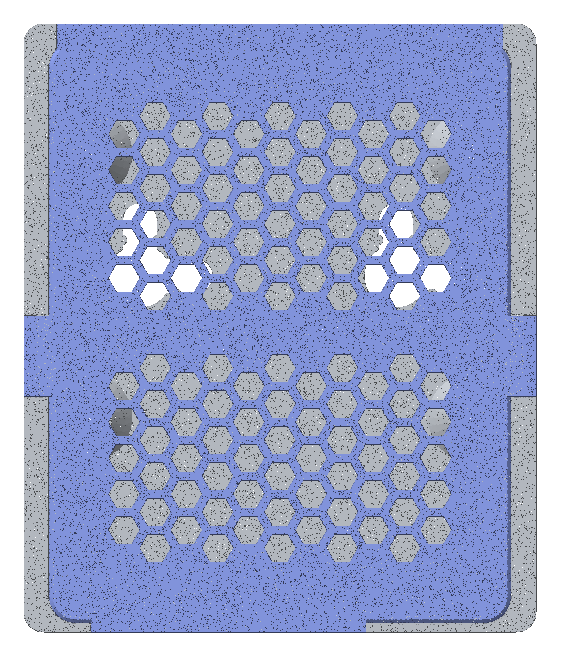
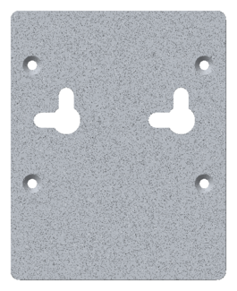
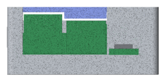
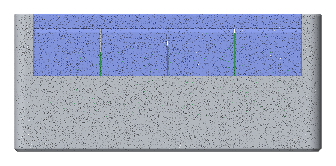
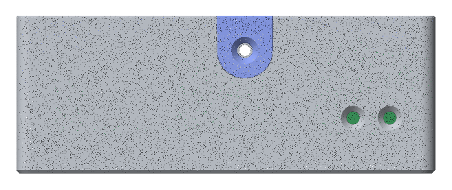

# 3D-printed case

A two-part FDM case for the Waveshare ESP32-P4-WIFI6-POE-ETH board:

- **Base:** one part with all four walls.
- **Lid:** a 3 mm honeycomb grille that clicks onto four corner tabs and is held by two side screws.

The screw ears come in two options, both built by `make case`, until a test print shows which one to keep:

- **Outside ears (default):** a U-shaped ear on each side of the lid sits flush in a pocket in the wall's outer face.
  The screw goes through the ear and threads into the wall (about 2.4 mm of thread).
- **Inside ears:** a buttressed block hangs from the lid inside each side wall. The screw goes through the wall and
  threads into the block (about 4.6 mm of thread, but along the lid's printed layers).

It hangs on a wall from two screws, cable end down or SMA side up, or it lies on a table. Everything you need day to day
is reachable with the lid on: the USB-C, USB-A and RJ45 (PoE) ports, the microSD slot, BOOT and RESET (with a pencil),
an SMA antenna, and wiring on the 40-pin header.


| Front (lid) | Back (keyholes, screw holes) |
| --- | --- |
|  |  |

| Cable end | Header end | Button side |
| --- | --- | --- |
|  |  |  |

`make case` renders all of these into `dist/case/`.

Ready-to-print STLs of the current design (outside ears) are in the repository: [base](models/p4_case_base.stl) and
[lid](models/p4_case_lid.stl). On GitHub, opening either one shows an interactive 3D view.

The model is parametric Python (build123d) in `case/`. Its design is
`docs/superpowers/specs/2026-11-02-p4-case-design.md`.

## Building the files

```
make case-board   # once: download and verify the vendor 3D model of the board (.artifacts/board/)
make case         # write dist/case/, run the fit checks, refresh docs/models/
make case-test    # the model's tests (about 5 min)
```

`dist/case/` then holds:

| File | Use |
| --- | --- |
| `p4_case_base.stl` | print: back plate down |
| `p4_case_lid.stl` | print: top face down (the file is already flipped) |
| `p4_case_base.step`, `p4_case_lid.step` | CAD, as assembled (Z 0 at the outer back face) |
| `p4_case_*_inside-ears.{stl,step}` | the same for the inside-ear option |
| `preview_*.png` | front, back, both ends, button side, exploded (default option) |

`make case` also copies the two STLs to `docs/models/`, which is committed; a test fails when they no longer match a
fresh build, so commit them with every geometry change.

`make case` runs every check for both ear options, prints one line per check and fails if any check fails. The
checks are:

- the board facts still match the vendor model;
- clearance to the board is at least 0.3 mm;
- every opening has a clear path to its part; the 40-pin slot is closed by the lid's curtain and clear once it's
  broken out;
- each screw ear's hole lines up with its pilot, and the pilot is long enough;
- the board can be fitted (drop in, slide forward, settle);
- the lid clears the SMA, a ribbon plug and its ribbon, and a ribbon plug has headroom under the lid;
- the screw heads have room behind the keyholes, and the board screws' heads have room on top;
- the lid seats on the base without overlap, apart from the bumps' designed preload;
- the lid's bumps reach past the wall face and press lightly into their dents;
- the SMA bulkhead's nut has room inside, clear of the board;
- no opening is wider than 3.5 mm while the curtain is on (the broken-out slot is 5 mm tall);
- both parts are closed solids;
- both parts print without supports (bridges up to 18 mm);
- no layer of either part holds a strand thinner than 0.8 mm (two lines), which a slicer would print as one line or
  drop.

## Printing

- PETG is best because the lid tabs flex. PLA works on a table if you'll rarely open the lid. For wall mounting, use
  PETG: PLA creeps under the screws' constant load, and near a warm board.
- 0.4 mm nozzle and 0.2 mm layers. The detent bumps sit on a layer centre at 0.2 mm layers.
- No supports, no brim needed.
- Turn on your slicer's elephant's-foot (first-layer) compensation if it has one. The keyholes and the lid's top edge
  are chamfered on the bed side, so a little squish won't narrow them, and the base's outer bottom edge is chamfered so
  it won't leave a lip.
- **Base:** back plate on the bed. The only bridges are the top of the microSD slot (12 mm) and the 1 mm ledge above
  it. The SMA hole's round top prints without support.
- **Lid:** top face on the bed, the tabs, ears, curtain and cable-end lintel pointing up. Give it solid (100 %)
  infill, or at least 4 perimeters. The tabs grow layer by layer along their length, so bending them when the lid
  clicks in pulls across the layer bonds, the weakest direction. That's why they're thick and have a 45° gusset at the
  root. The curtain's break line is one of those layer bonds, on purpose.

## Parts

| Part | Count | Notes |
| --- | --- | --- |
| M2.5 × 6 pan-head screw | 4 | board to standoffs, from the top; it cuts its own thread in the standoff's Ø2.2 pilot hole |
| SMA female bulkhead with u.FL/IPEX pigtail, about 8 cm | 1 | D-flat thread, Ø6.35; a long-thread one (≥ 9.5 mm) leaves enough thread outside the 4 mm wall for the antenna |
| Lid screws, outside ears: M2.5 × 6 flat head, self-tapping | 2 | through each ear into the side wall; the board's M2.5 × 6 pan heads also work (they sit about 1.7 mm proud) |
| Lid screws, inside ears: M2.5 × 10 flat head, self-tapping | 2 | through each side wall into the lid's block |
| Wall screws, 3.5 mm, pan head ≤ Ø7.5 × 2.5 mm | 2 | with wall plugs to suit; the shank clicks past a 3.3 mm neck in each keyhole arm |
| Stick-on rubber feet | optional | for the table |

## Assembly

1. **Board:** lower the board flat into the base, pushed toward the header end (there's 2 mm of room there). Lift it
   slightly and slide it toward the cable wall so the USB and RJ45 go into their holes, then let it settle onto the
   standoffs. Drive the four M2.5 screws from the top through the board into the standoffs. Go gently on the first
   turn: the screw cuts its own thread in the plastic. Snug it down and stop: the thread in the plastic strips if you
   keep turning. If one does strip, use a slightly bigger self-tapping screw: a 2.9 mm sheet-metal screw (ST2.9)
   still fits the board's Ø3 hole. Or drill the pilot out and use a countersunk M2.5 from the back, with a nut on top
   of the board; the back plate keeps a countersink under each standoff for that.
2. **SMA (optional):** the D-hole in the right wall is closed on the outside by a thin knock-out skin, so the case
   stays closed when you use an in-case antenna. To fit an SMA antenna, cut the skin (two lines thick) out along the
   hole's edge with a craft knife. Clip the pigtail onto the board's antenna socket, turn the bulkhead so its flat is
   at the bottom, push it out through the hole from inside, and tighten its nut on the outside over a washer: snug,
   not hard. The wall is 4 mm thick on this side, so the antenna can't lever it apart.
3. **Header wiring (optional):** the lid closes the 40-pin slot with a curtain of four segments. Break out as many as
   the wiring needs: grip a segment with tweezers or pliers and bend it in and out until it snaps off at the lid.
   Jumper wires need one segment, a 2×20 ribbon all four. Then plug the wiring onto the 40-pin header and lead it out
   through the slot: the gap is 5 mm tall once a segment is out.
4. **Lid:** set it on so the four corner tabs drop into the corners, and press until it clicks. The bumps then press
   it down onto the rim, so it doesn't rattle. Then drive the two lid screws through the side ears (outside ears) or
   through the side walls (inside ears). Snug only: they cut their own thread in the plastic.
5. **Opening:** take out the two lid screws, then lever the lid up through the grille with a small flat screwdriver,
   close to a corner.

BOOT and RESET sit behind the two pin-holes on the left wall, near the cable end. Press them with a pencil or a small
screwdriver; a small funnel at each hole's mouth guides the tip in.

## Mounting

The back plate has two L-shaped keyholes, 32 mm apart on the same line.

- **Cable end down:** set the two screws level, 32 mm apart. Hang the case on them and slide it down until the
  screws click past the neck in each keyhole arm.
- **SMA side up:** set the same two screws one above the other, 32 mm apart. Turn the case so the SMA wall is on top,
  hang it and slide it down until it clicks. The board's warm parts are then low in the case and the grille vents
  less well, so the case runs a little warmer than cable end down.

The necks keep the case from riding up its screws when you push a plug in. Still, hold the case with your other hand
when you plug in the PoE cable: an RJ45 plug can take up to about 20 N to seat.

Leave each screw head standing about 2.2 mm off the wall: the plate is 2 mm thick. The head sits inside the case behind
the plate and must not stand more than 2.5 mm proud of the plate's inner face.

## Tuning after a test print

Every dimension is a named constant in `case/p4_case/params.py`. The ones most likely to need a printer-specific tweak:

| Constant | Default | Change it when |
| --- | --- | --- |
| `BUMP_H` | 0.4 mm | the lid clicks too hard (lower) or opens too easily (raise); the dents follow it |
| `DENT_PRELOAD` | 0.1 mm | the lid rattles (raise) or won't fully seat (lower) |
| `LID_CLEAR` | 0.2 mm | the lid binds in the rebate (raise) or rattles (lower) |
| `TAB_CLEAR` | 0.2 mm | the tabs scrape the walls (raise) |
| `SCREW_HOLE_D` | 2.2 mm | M2.5 screws are too hard to drive (raise) or don't grip (lower; about 1.7 for M2) |
| `KEY_ARM_W` | 4.3 mm | the wall screws' shanks do not slide in the keyhole arms |
| `KEY_NECK_W` | 3.3 mm | the shank won't pass the neck (raise) or doesn't click (lower) |
| `EAR_PILOT_D` | 2.2 mm | outside ears: the lid screws are too hard to drive (raise) or don't grip (lower) |
| `IN_EAR_PILOT_D` | 2.4 mm | inside ears: the screw splits the lid's block (raise) or doesn't grip (lower) |
| `CURTAIN_NECK` | 0.8 mm | curtain segments break off by themselves (raise) or won't snap off (lower) |

After a change, run `make case` again. Its checks catch a change that breaks a fit.

## Limits

- The fit is checked automatically against Waveshare's 3D model (`ESP32-P4-WIFI6-POE-ETH_3d-20251213`) and was tested
  on a printed case (PETG) with a real board: the board, every connector, the microSD card, both buttons, the SMA
  antenna and the lid all fit. The changes since came from that print (screw pilots, the 4 mm SMA and button walls,
  the knock-out, the scoop above the card slot, the walls at the 40-pin end, larger bumps, the button funnels) and from
  a design review (keyhole necks and chamfers, the detent's hold face and preload, the SMA hole's flat at the bottom,
  the two-line knock-out, the tab gussets, the full-width header slot). That second print confirmed the bumps, the
  keyhole necks and the standoff blocks. v6 followed from it: a 3 mm lid on a 1 mm taller case, the lid screws (two
  options), the 40-pin curtain with a 3 mm header-end wall, a bigger microSD scoop without the lip, and the SMA hole's
  round top again. v6 hasn't been printed yet.
- The camera and display ribbon sockets, the two 4-pin sockets and the battery socket stay covered.
- The power LED stays covered by the lid's frame.
