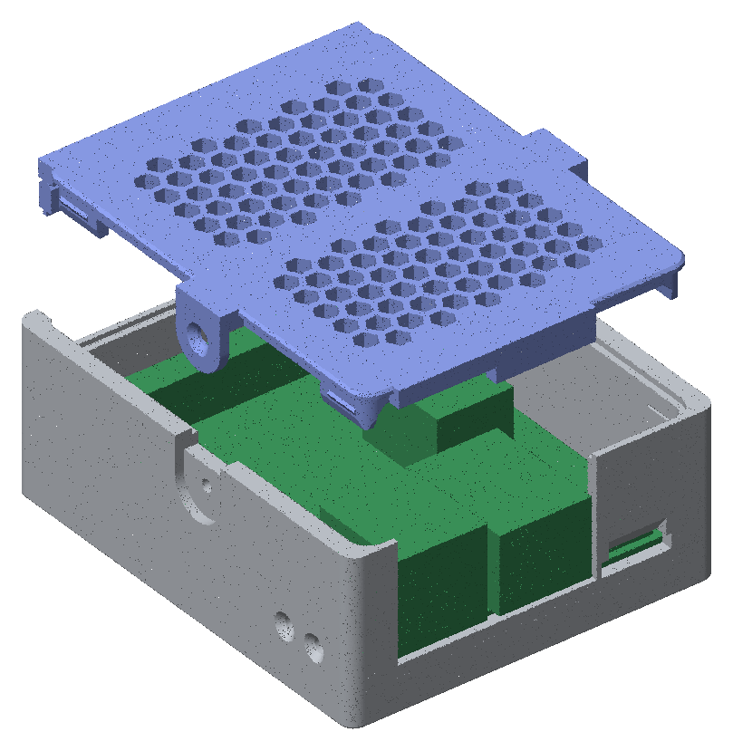

# 3D-printed case

A two-part FDM case for the Waveshare ESP32-P4-WIFI6-POE-ETH board:

- **Base:** one part with all four walls.
- **Lid:** a honeycomb grille that clicks onto four corner tabs.

It hangs on a wall from two screws, cable end down or SMA side up, or it lies on a table. Everything you need day to day
is reachable with the lid on: the USB-C, USB-A and RJ45 (PoE) ports, the microSD slot, BOOT and RESET (with a pencil),
an SMA antenna, and wiring on the 40-pin header.



The model is parametric Python (build123d) in `case/`. Its design is
`docs/superpowers/specs/2026-11-02-p4-case-design.md`.

## Building the files

```
make case-board   # once: download and verify the vendor 3D model of the board (.artifacts/board/)
make case         # write dist/case/ and run the fit checks
make case-test    # the model's tests (about 1.5 min)
```

`dist/case/` then holds:

| File | Use |
| --- | --- |
| `p4_case_base.stl` | print: back plate down |
| `p4_case_lid.stl` | print: top face down (the file is already flipped) |
| `p4_case_base.step`, `p4_case_lid.step` | CAD, as assembled (Z 0 at the outer back face) |
| `preview_*.png` | front, back, both ends, button side, exploded |

`make case` prints one line per check and fails if any check fails. The checks are:

- the board facts still match the vendor model;
- clearance to the board is at least 0.3 mm;
- every opening has a clear path to its part;
- the board can be fitted (start tilt 5°);
- the lid clears the SMA, a ribbon plug and its ribbon;
- the screw heads have room behind the keyholes, and the board-screw nuts have room on top;
- the lid seats on the base without overlap, and the LED shows through it;
- no opening is wider than 3.5 mm;
- both parts are closed solids;
- both parts print without supports (bridges up to 18 mm).

## Printing

- PETG is best because the lid tabs flex. PLA works if you'll rarely open the lid.
- 0.4 mm nozzle and 0.2 mm layers.
- No supports, no brim needed.
- **Base:** back plate on the bed. The tops of the cable-wall openings bridge up to 17 mm.
- **Lid:** top face on the bed, tabs pointing up. Give it solid (100 %) infill, or at least 4 perimeters. The tabs grow
  layer by layer along their length, so the layer bonds take the load when the lid clicks in.

## Parts

| Part | Count | Notes |
| --- | --- | --- |
| M2.5 × 12 countersunk (flat-head) screw, ISO 10642 / DIN 7991 | 4 | board to standoffs, from the back |
| M2.5 nut | 4 | on top of the board |
| SMA female bulkhead with u.FL/IPEX pigtail, about 8 cm | 1 | D-flat thread, Ø6.35 |
| Wall screws, 3.5–4 mm, pan head ≤ Ø7.5 × 2.5 mm | 2 | with wall plugs to suit |
| Stick-on rubber feet | optional | for the table |

## Assembly

1. **Board:** tilt the board header end up, slide the USB and RJ45 into their holes in the cable wall, and lower the
   header end onto the standoffs. Push the four countersunk screws in from the back through the standoffs and the board,
   and tighten a nut on each from the top.
2. **SMA:** clip the pigtail onto the board's antenna socket. Push the SMA bulkhead out through the D-hole in the right
   wall from inside, and tighten its nut on the outside.
3. **Header wiring (optional):** plug jumper wires or a 2×20 ribbon plug onto the 40-pin header and lead the wires out
   through the slot in the header-end wall. The way in under the lid is 3.5 mm tall.
4. **Lid:** set it on so the four corner tabs drop into the corners, and press until it clicks.
5. **Opening:** lever the lid up through the grille with a small flat screwdriver, close to a corner.

BOOT and RESET sit behind the two pin-holes on the left wall, near the cable end. Press them with a pencil or a small
screwdriver.

## Mounting

The back plate has two L-shaped keyholes, 32 mm apart on the same line.

- **Cable end down:** set the two screws level, 32 mm apart. Hang the case on them and slide it down.
- **SMA side up:** set the same two screws one above the other, 32 mm apart. Turn the case so the SMA wall is on top,
  hang it and slide it down.

Leave each screw head standing about 2.2 mm off the wall: the plate is 2 mm thick. The head sits inside the case behind
the plate and must not stand more than 2.5 mm proud of the plate's inner face.

## Tuning after a test print

Every dimension is a named constant in `case/p4_case/params.py`. The ones most likely to need a printer-specific tweak:

| Constant | Default | Change it when |
| --- | --- | --- |
| `BUMP_H` | 0.4 mm | the lid clicks too hard (lower) or falls off (raise) |
| `LID_CLEAR` | 0.2 mm | the lid binds in the rebate (raise) or rattles (lower) |
| `TAB_CLEAR` | 0.2 mm | the tabs scrape the walls (raise) |
| `SCREW_HOLE_D` | 2.8 mm | the M2.5 screws bind in the standoffs |
| `KEY_ARM_W` | 4.3 mm | the wall screws' shanks do not slide in the keyhole arms |

After a change, run `make case` again. Its checks catch a change that breaks a fit.

## Limits

- The fit is checked against Waveshare's 3D model (`ESP32-P4-WIFI6-POE-ETH_3d-20251213`), not yet against a printed case
  with a real board.
- The camera and display ribbon sockets, the two 4-pin sockets and the battery socket stay covered.
- There's no light pipe for the LED; it shows through the grille.
