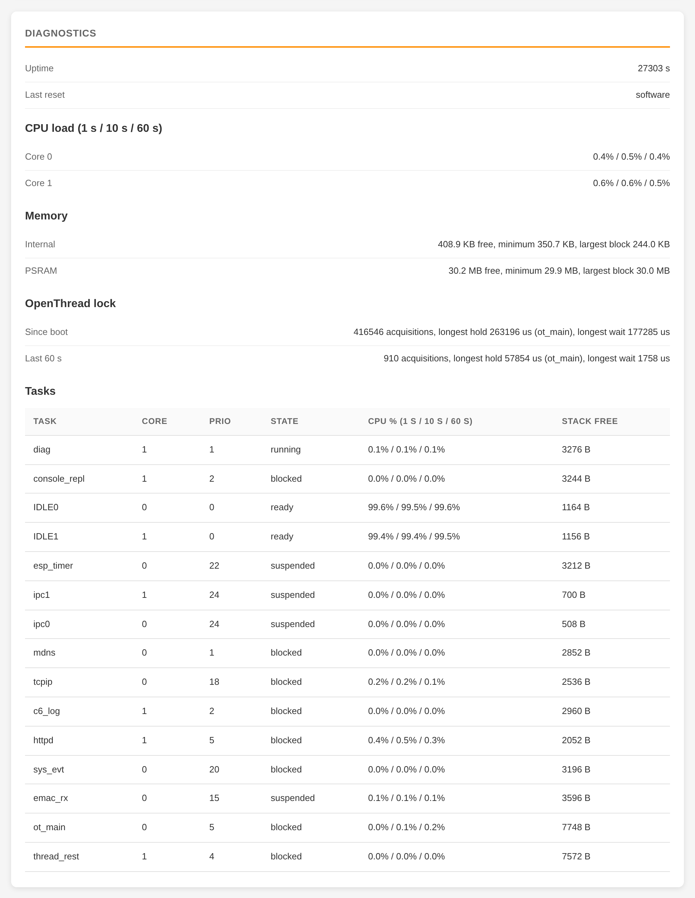

# Monitoring

Two ways to watch the board: the **Diagnostics** page for a quick look, and [Prometheus metrics](metrics.md) for history
and alerts.

## Diagnostics page

**Device > Diagnostics** refreshes every 2 seconds:

- **CPU load** of both cores over the last 1, 10 and 60 seconds.
- **Memory:** free internal RAM and PSRAM, and the lowest they have been since boot. Internal RAM falling steadily over
  days points at a leak; please report it.
- **OpenThread lock:** how long parts of the firmware wait for, and hold, the Thread stack. Long waits explain slow
  REST answers.
- **Tasks:** every task's CPU share and how close it came to running out of stack.
- Uptime and the reason for the last reset.

The **chip temperature** is on the Dashboard. It is the chip's own temperature, not the room's: it reads above room
temperature and rises with load. It shows `-` when the sensor can't be read.

API: `GET /device/diag` ([HTTP API](api.md#device-api)). Details of the figures:
[Internals](reference/internals.md#diagnostics).
