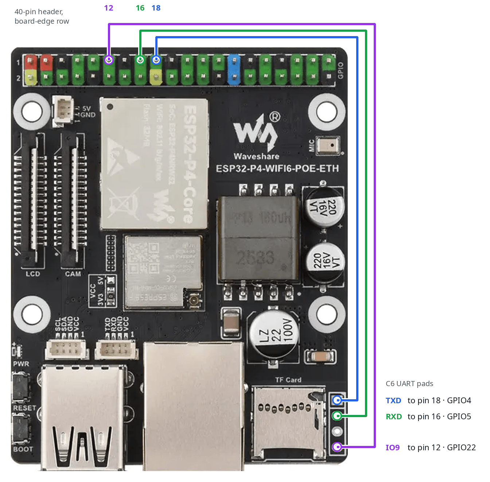
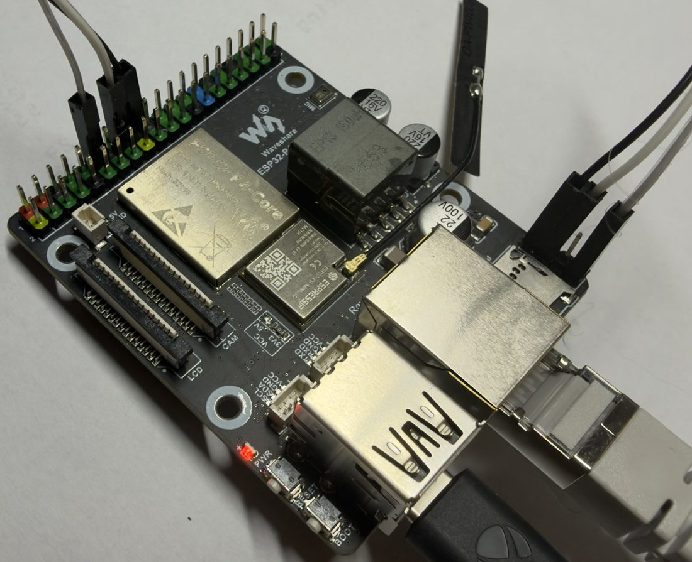
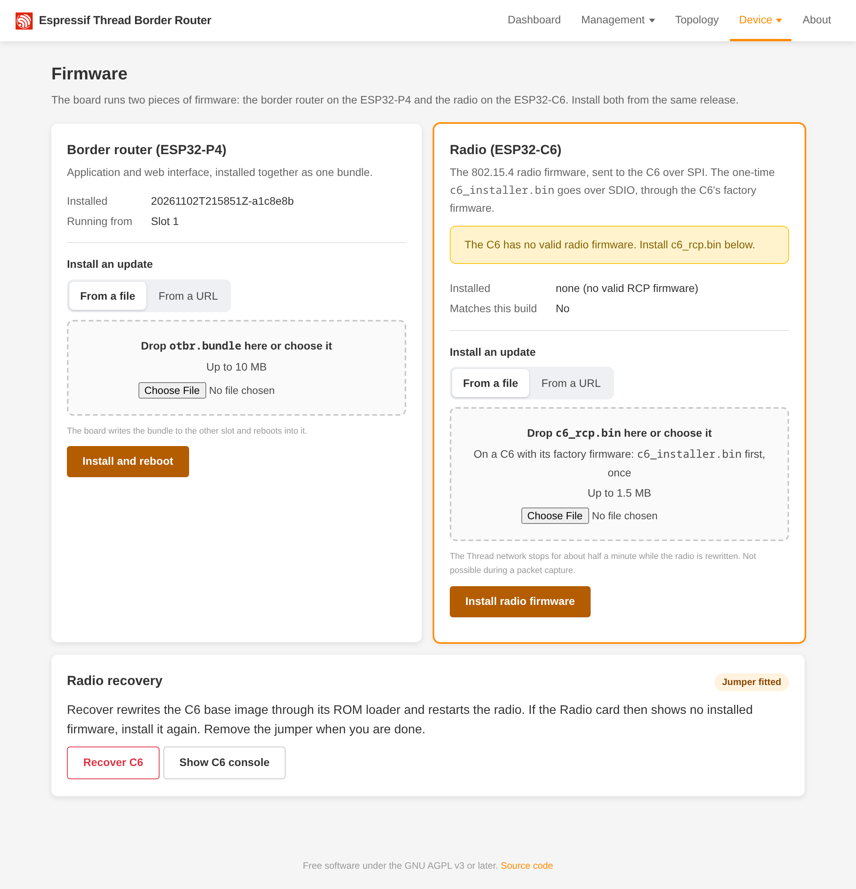
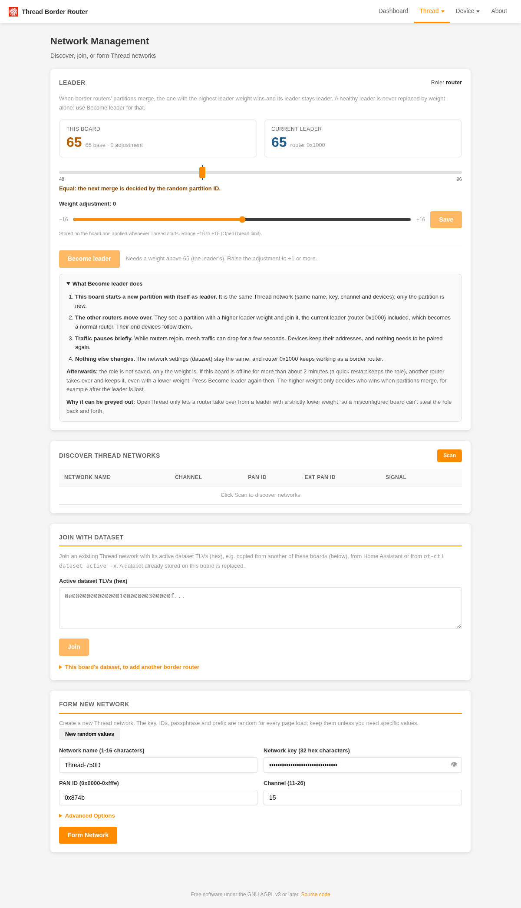

# First install

How to bring a new Waveshare ESP32-P4-WIFI6-POE-ETH to a working border router. The C6 radio module ships with
Espressif's ESP-Hosted firmware, which this project overwrites. Three paths:

- **No wires** (Path 1, factory C6): the P4 replaces ESP-Hosted through ESP-Hosted's own update mechanism. Two uploads:
  `c6_installer.bin` once, then `c6_rcp.bin`. Tested with an ESP-Hosted stand-in (see the note there).
- **With the maintenance jumper** (Path 2, three wires): only the P4 USB-C port is needed, and the jumper also repairs a
  broken C6 later.
- **USB-UART on H7** (Path 3): a 3.3 V adapter on the C6 header writes the first C6 images.

Every path needs an antenna and ends with the RCP firmware upload.

## Before you start

- Hardware: the Waveshare ESP32-P4-WIFI6-POE-ETH (ESP32-P4 chip revision v1.3, 32 MB flash, 32 MB PSRAM, IP101 Ethernet
  PHY, ESP32-C6 module with 8 MiB flash), a USB-C cable to the P4 port (flashing and console; a CH343 serial port,
  `/dev/ttyACM0` on Linux) and Ethernet (PoE or a separate USB supply). Optional: the maintenance jumper wires (Path 2),
  or a 3.3 V USB-UART adapter (Path 3).
- Attach a **2.4 GHz antenna to the C6 IPEX connector**. Without it the radio range is a few centimetres and the Thread
  network will not form reliably.
- Connect Ethernet (a DHCPv4 network; IPv6 router advertisements are used when present).
- Build everything with `make build` ([Building](building.md)): you need `p4/build/` (P4 firmware),
  `c6_rcp/build/c6_rcp.bin` (radio firmware), for Path 1 `c6_installer/build/c6_installer.bin` and for Path 3
  `c6_updater/build/`. Without a checkout, take `p4-flash.zip`, `c6_rcp.bin` and, for Path 1, `c6_installer.bin` or, for
  Path 3, `c6-updater-flash.zip` from a GitHub release. `c6_installer.bin` must carry the same C6 base version as
  the P4 firmware: take it from the same build or release.
- Tools: ESP-IDF (the Makefile activates it; it also provides `esptool`), `curl`.
- The board's USB-C port shows up as a serial port (`/dev/ttyACM0` below).

## Path 1: no wires (factory C6)

> **NOTE: tested with a stand-in, not yet on an untouched factory C6.** The path ran end to end on the board with the
> ESP-Hosted 0.0.27 C6 slave (the version range the factory P4 image points to) written to the C6 as-is. A factory C6 may
> run another ESP-Hosted version; the protocol is the same from 0.0.6 to 2.x. If it fails, the C6 normally still runs
> ESP-Hosted (or the installer) and Path 2 or 3 still works.

For a C6 that still runs its factory ESP-Hosted firmware and has no jumper fitted. ESP-Hosted can update itself from the
P4 over the SDIO lines between the chips; the P4 uses that once to send `c6_installer.bin`, a small C6 app that writes
the C6 bootloader, partition table and updater, then restarts into the updater. From then on the C6 is updated like on
any other board.

1. Flash the P4 as in Path 2 step 1.
2. The board boots, the P4 probes the C6 (three attempts, about 10 s), finds the updater silent and then ESP-Hosted
   answering on SDIO. Nothing is written to the C6. `/device/status` shows `"mode":"RADIO_FAULT"`,
   `"fault_reason":"esp-hosted firmware"`; the Firmware page says to install `c6_installer.bin` first.
3. Upload the installer, with the Firmware page ("Radio") or:

   ```
   curl --data-binary @c6_installer/build/c6_installer.bin http://<board>/device/radio/firmware
   ```

   (with a release file: `curl --data-binary @c6_installer.bin http://<board>/device/radio/firmware`)

   It takes about a minute: ESP-Hosted erases a slot, stores the installer (about 10 s) and restarts into it; the installer
   waits 30 s (so that no reset from a booting P4 can hit its writes), writes the updater, bootloader and partition table
   (about 2 s) and restarts; the P4 waits for the updater to answer and never resets the C6 meanwhile. Do not power off
   the board until the reply arrives: a power cut while the C6 bootloader or partition table is written leaves a C6 that
   only Path 2 or 3 can repair. The reply is `{"installed": null}` and the status shows `"fault_reason":"no rcp firmware"`,
   with `jumper.base_installed` equal to `jumper.base_expected`.

   Refusals, nothing written: 400 `invalid_image` when the file is not `c6_installer.bin` (`c6_rcp.bin` cannot be sent
   to ESP-Hosted) or when its C6 base version differs from the P4's (another release; the detail names both versions). 502 `install_failed` when the
   transfer to ESP-Hosted failed (the detail names the step); the C6 then still runs ESP-Hosted, retry the upload.
4. Upload the radio firmware as in Path 2 step 4. The border router starts and the mode becomes `BR_RUNNING`.

## Maintenance jumper wiring

Optional. Solder or clip three wires between the C6 UART pads H7 and the P4 40-pin header. H7 is the column of four
2.54 mm through-hole pads right of the TF card slot; the back of the board names them TXD, RXD, GND and IO9 (pin 1, the
square pad, is TXD). The header pins are in the row along the board edge.



| H7 pin | Signal | P4 header pin | P4 GPIO | Name in the firmware |
| --- | --- | --- | --- | --- |
| 1 | `C6_U0TXD` (C6 transmits, P4 receives) | 18 | GPIO4 | `JUMPER_RX` |
| 2 | `C6_U0RXD` (P4 transmits, C6 receives) | 16 | GPIO5 | `JUMPER_TX` |
| 3 | GND | (14) | GND | not needed: both chips share the board's ground |
| 4 | `C6_IO9` (C6 boot strap, low at reset = ROM download) | 12 | GPIO22 | `JUMPER_BOOT` |

Board photo: Waveshare ([ESP32-P4-WIFI6-POE-ETH documentation](https://docs.waveshare.com/ESP32-P4-WIFI6-POE-ETH)),
dimension lines removed and wiring drawn on.

The easiest way: solder a 4-pin 2.54 mm pin header into H7 and use female-to-female Dupont jumper wires. TXD and RXD sit
next to each other on both ends (H7 pads 1 and 2, header pins 18 and 16), so a two-pin Dupont housing fits there; IO9 to
pin 12 is a single wire, and H7 pad 3 and header pin 14 stay free:



Leave header pins 15 (GPIO6) and 32 (GPIO54) alone: they are already wired to the C6 on the board (update select and reset).
The pins are fixed in `p4/main/board.h`. The firmware detects the jumper by itself at boot.

## Path 2: with the jumper (P4 USB-C only)

1. Connect the USB-C cable to the P4 port and flash the P4 (`PORT=/dev/ttyACM0` by default). The `make erase` line is only
   for a board that ran something else before (see [Building](building.md#flash)); it also deletes the stored Thread dataset
   and network configuration, so skip it on a board in service:

   ```
   # make erase
   make flash
   make monitor
   ```

   With a release instead: unpack `p4-flash.zip` and run `esptool --chip esp32p4 -p /dev/ttyACM0 write-flash @flash_args`
   in it.

2. The board boots and gets its Ethernet address (log: `eth: got ip`). The P4 probes the C6 (three attempts, about 10 s,
   `rcp_sync: attempt N: no HELLO reply`); the factory ESP-Hosted firmware does not speak the updater protocol, so
   the updater is silent, and the P4 starts the automatic ROM recovery over the jumper (`ROM recovery of the C6 base image
   (updater not responding)`): it puts the C6 into ROM download mode, writes the C6 bootloader, partition table and
   the updater, and resets the C6. The recovery takes a few seconds and runs at most once per boot. The log shows
   `writing bootloader`, `writing partition table`, `erasing otadata`, `writing updater`, then `c6:` lines from the C6 console.
   If the ROM link has a transmission error (`Error: INVALID_CRC` in the log) the recovery fails and the board reports
   `RADIO_FAULT` `rom recovery failed`: reboot it, or run `curl -X POST http://<board>/device/radio/recover` (see step 3).
3. After the recovery the updater answers but there is no RCP firmware yet, so the board reports `RADIO_FAULT`, about 20 s after power-on:

   ```
   curl http://<board>/device/status
   ```

   shows `"mode":"RADIO_FAULT"`, `"fault_reason":"no rcp firmware"` and `"rcp":{"installed":"", ...}`, and
   `jumper.base_installed` equal to `jumper.base_expected`. The board's address is in the log and in `eth.ipv4`;
   `http://esp-otbr-<last three MAC bytes>.local` works where mDNS does. If `fault_reason` is `rom recovery failed`
   instead, run `curl -X POST http://<board>/device/radio/recover` and look at `/device/status` again. On a C6 that has no RCP
   firmware this request answers 200 `{"recovered":true,"rcp":"no rcp firmware",...}` (OpenThread cannot start without
   firmware: the status shows `no rcp firmware`); `recovery_failed` (502) means the recovery itself failed.
4. Upload the radio firmware on the Firmware page (`http://<board>/firmware.html`, "Radio"). The page highlights the
   Radio card while the C6 has no radio firmware:

   

   Or from a checkout:

   ```
   make radio BOARD=<board>
   ```

   (with a release file: `curl --data-binary @c6_rcp.bin http://<board>/device/radio/firmware`)

   The upload takes about 3 seconds. The reply is `{"installed": "<version>"}`; the border router starts and the mode becomes `BR_RUNNING`.
5. Create a Thread network (see below). The board never forms or joins a network by itself.

## Path 3: USB-UART on H7 (3.3 V adapter)

> **NOTE: untested on hardware.** This path was derived from the code and the ROM loader documentation but never run on the
> board: neither the esptool sequence below, nor recovery of a truly blank C6 (bootloader, partition table and otadata
> erased), nor overwriting the factory ESP-Hosted firmware. Expect to adjust it; if you have the jumper, use Path 2.

Use this when the C6 has never been written, or when the updater, bootloader or partition table of the C6 is broken and no
jumper is fitted. You write the three C6 images yourself with `esptool` over H7, once.

1. Wire a 3.3 V USB-UART adapter to H7: adapter RX to H7 pin 1 (C6 TX), adapter TX to H7 pin 2 (C6 RX), adapter GND
   to H7 pin 3. 3.3 V logic only. Tie H7 pin 4 (IO9) to GND.
2. Put the C6 into ROM download mode: with IO9 grounded, reset the C6 by a power cycle of the whole board (unplug and replug USB-C; the P4 also
   resets the C6 when it boots). To keep the P4 from interfering, erase it first: `make erase` (a P4 without firmware does
   not touch the C6).

   **Warning:** this erases the whole P4 flash: its firmware, the stored Thread dataset and the network configuration. If the
   board is in service, first save the dataset, e.g. `curl -H 'Accept: text/plain' http://<board>/node/dataset/active > dataset.tlv`
   (the TLVs; `GET /node/dataset/active` also works with the default JSON), and reflash the P4 afterwards (step 4).
3. Write the C6 images from the `c6_updater` build, offsets from `common/c6_board/c6_board.h` and `partitions_c6.csv`
   (bootloader at 0x0, partition table at 0x8000, updater into the `test` partition at 0x20000). `C6_PORT` is your adapter:

   ```
   make c6-flash-base C6_PORT=/dev/ttyUSB0
   ```

   With a release instead: unpack `c6-updater-flash.zip` and run, in it,

   ```
   esptool --chip esp32c6 -p /dev/ttyUSB0 --before no-reset --after no-reset erase-flash
   esptool --chip esp32c6 -p /dev/ttyUSB0 --before no-reset --after no-reset write-flash @flash_args
   ```

   **Warning:** the C6 erase wipes the whole C6 flash, including both RCP firmware slots. The RCP firmware is gone
   afterwards and must be uploaded again (`c6_rcp.bin`, step 4 of Path 2).

   (The layout is 4 MB-safe; the C6 has 8 MiB of flash and the rest stays unused.)
4. Remove the IO9-to-GND wire and the adapter. Flash the P4 as in Path 2 step 1 and continue with step 3 there: the updater
   answers, there is no RCP firmware, `RADIO_FAULT` `no rcp firmware`, and you upload `c6_rcp.bin`.

## Creating a Thread network

The board needs a dataset before it does anything. Either:

- Web UI: `http://<board>/network.html`, "Form" a new network, "Join" a scanned one, or "Join with Dataset" with the
  active dataset TLVs (hex) of an existing network; then check the dashboard.

  

- Home Assistant: add the OpenThread Border Router integration with the URL `http://<board>`; it creates or imports the
  dataset. See [Home Assistant](home-assistant.md).
- `python-otbr-api` (`pip install python-otbr-api aiohttp`):

  ```
  import asyncio, aiohttp, python_otbr_api as api

  async def main():
      async with aiohttp.ClientSession() as session:
          otbr = api.OTBR("http://<board>", session)
          await otbr.create_active_dataset(api.models.ActiveDataSet(network_name="MyThread", channel=15))
          await otbr.set_enabled(True)

  asyncio.run(main())
  ```

Within about half a minute `curl http://<board>/node/state` goes from `"detached"` to `"leader"` (alone on the network) and `/device/status` has
`"mode":"BR_RUNNING"`. Other Thread devices join with the dataset (`curl -H 'Accept: text/plain' http://<board>/node/dataset/active` prints the TLVs). The dataset is stored on the board and survives reboots.

## Troubleshooting the first install

- `RADIO_FAULT` `rom recovery failed` (jumper path): check the four wires and their pin positions, then
  `curl http://<board>/device/radio/log` for the C6 output and `curl -X POST http://<board>/device/radio/recover`.
- `RADIO_FAULT` `esp-hosted firmware`: the C6 still runs its factory firmware and no jumper was seen; follow Path 1
  from step 3 (or fit the jumper and reboot for Path 2).
- `/device/status` shows `jumper.present: false` with wires fitted: IO9 wire loose, or the TX/RX pair swapped.
- `rcp incompatible` after the upload: the `c6_rcp.bin` does not match the P4's OpenThread build; use the one built from
  the same commit.
- No address: check the Ethernet cable and DHCP, the log shows `eth:` lines; the console command `net show` prints
  the interface state.
- Upload returns 409 `busy`: another long operation is running or the border router is starting; wait and retry.

## Recovery procedures

- **Board unreachable after a network change** (VLANs, static IP): the change reverts on its own 5 minutes after the
  reboot unless it was confirmed. Or use the P4 console (`make monitor`, USB-C, 115200 baud): `net reset` restores `single`, untagged,
  DHCPv4 and reboots; `net show` prints the config.
- **C6 broken** (bootloader, partition table or updater damaged, RCP firmware missing): with the jumper the P4 repairs it at boot (once per boot), or
  `curl -X POST http://<board>/device/radio/recover` / "Recover C6" on the Firmware page; then upload `c6_rcp.bin` if
  `fault_reason` says `no rcp firmware`. Without the jumper use Path 3.
- **P4 broken** (bad OTA that cannot roll back, corrupt flash): reflash over USB-C, `make erase flash`
  (this deletes the stored dataset and network settings). If the P4 will not enter download mode, hold BOOT while pressing reset.
- **Factory state**: the original ESP-Hosted C6 firmware and the P4 factory image are not part of this repository; take them
  from Waveshare / Espressif if you want to return to stock.
