# First install

How to turn a new Waveshare ESP32-P4-WIFI6-POE-ETH into a working Thread border router. It takes three steps:

1. [Flash the P4](#1-flash-the-p4), the main chip, over USB-C.
2. [Put the radio firmware on the C6](#2-put-the-radio-firmware-on-the-c6), the radio chip, from the board's web page.
3. [Give the board a Thread network](#3-give-the-board-a-thread-network), from Home Assistant or the web page.

## What you need

- The board: Waveshare ESP32-P4-WIFI6-POE-ETH.
- A **2.4 GHz antenna** on the C6's antenna connector. Without it the radio reaches a few centimetres and the Thread
  network will not form reliably.
- A **USB-C cable** to a computer with Chrome or Edge, for the first flash.
- **Ethernet** with DHCP. The board is powered over PoE, or over USB-C when your switch has no PoE.
- From the [latest release](https://github.com/t3hk0d3/esp32-p4-otbr/releases/latest): `c6_installer.bin` and
  `c6_rcp.bin`. Take every file from the same release.

The connectors you need:



| Part | Where | Used for |
| --- | --- | --- |
| USB-C port | bottom edge, left, stacked with the USB-A port | flashing, the console, power without PoE |
| Ethernet (RJ45) | bottom edge, middle | network and PoE power |
| USB-A port | bottom edge, left, stacked with the USB-C port | an optional USB radio dongle ([Radios](radios.md)) |
| C6 antenna connector (IPEX) | corner of the small ESP32-C6 module | the 2.4 GHz antenna |
| H7 | four pads right of the TF card slot | the optional [maintenance jumper](#maintenance-jumper-wiring) or a USB-UART adapter |
| RESET and BOOT buttons | left of the USB ports | forcing the P4 into download mode if flashing fails |

## 1. Flash the P4

Connect the board's P4 USB-C port to your computer, then open [Flash in the browser](flash.md). Press **Detect board**,
then **Install**. The page reads the chip revision and picks the firmware built for it. On a new board, tick
**Erase the flash first**. The page then goes on to the radio firmware (step 2) over the same cable.

??? note "Other ways to flash"
    - With `esptool`: unpack `full_ESP32-P4-WIFI6-POE-ETH_<chip_id>.zip` from the release and run, inside it,
      `esptool --chip esp32p4 -p /dev/ttyACM0 write-flash @flash_args`. The `<chip_id>` is `ESP32-P4-rev1.3` for a chip
      below v3 and `ESP32-P4-rev3.0` for v3.1 and later. Older releases have only `p4-flash.zip`, for chips below v3.
    - From a checkout: `make flash` (see [Building and flashing](building.md)).

The board restarts and gets an address over Ethernet. Open its web page: `http://esp-otbr-<last six hex digits of the
MAC>.local/`, or the IP address your router lists for `esp-otbr`. The Dashboard says what is missing next: on a new board,
the radio firmware.

## 2. Put the radio firmware on the C6

If you flashed in the browser and it said **Radio firmware installed**, this step is done: go on to
[3. Give the board a Thread network](#3-give-the-board-a-thread-network).

A new board's C6 runs Espressif's factory firmware ([ESP-Hosted](glossary.md)), which this project replaces. Pick a way:

| Your board | Way |
| --- | --- |
| New, no extra wires (most people) | [A: no wires](#a-no-wires) |
| Three jumper wires fitted, or you can fit them | [B: maintenance jumper](#b-with-the-maintenance-jumper) |
| A and B failed, and you have a 3.3 V USB-UART adapter | [C: USB-UART adapter](#c-usb-uart-adapter) |

Every way ends with [uploading the radio firmware](#upload-the-radio-firmware).


### A: no wires

The board sends a small installer through the C6's factory firmware; the installer then sets up the C6 for this
project. You give the board the files either from [Flash in the browser](flash.md) or from its own web page.

!!! note "Tested with a stand-in"
    This way ran end to end on the board with ESP-Hosted 0.0.27 on the C6, the version the factory image points to,
    but not yet on an untouched factory C6. If it fails, the C6 still runs its factory firmware or the installer, and
    way B or C still works.

**From the browser flasher.** Right after it has flashed the P4, the page asks the board about the C6. On a new board
it offers `c6_installer.bin`, then `c6_rcp.bin`, both from the same release. Press **Install radio firmware** and keep
the board powered and connected for about 5 minutes, until the page says **Radio firmware installed**. **Don't power
off the board meanwhile**: a power cut while the installer writes leaves a C6 that only way B or C can repair. If the
cable comes out, the board carries on by itself; plug it back in and press **Reconnect**. What the page's other
messages mean: [Flash in the browser](flash.md#the-radio-firmware).

**From the board's web page:**

1. The Dashboard shows **Radio fault**: the C6 still runs its factory firmware.
2. Open **Device > Firmware**. On the **Radio Co-Processor** card, choose `c6_installer.bin` and press
   **Install radio firmware**.
3. Wait about a minute until the page answers. **Don't power off the board meanwhile**: a power cut while the installer
   writes leaves a C6 that only way B or C can repair.
4. The Dashboard now says the C6 has no radio firmware. Continue with [Upload the radio firmware](#upload-the-radio-firmware).

If the upload (or the browser flasher) reports an error: `invalid_image` means the file is not `c6_installer.bin`, or it comes from another release
than the board's firmware. `install_failed` means the transfer failed or got no answer at its end. The C6 may then still run its factory
firmware, or it may already have taken the installer: wait a minute without powering off, then reload the Dashboard. If
it still says **esp-hosted firmware**, upload the installer again; if it says the C6 has no radio firmware, the
installer finished, so continue with [Upload the radio firmware](#upload-the-radio-firmware).

### B: with the maintenance jumper

Three wires between the C6 and the P4 let the board rewrite the C6 by itself, now and whenever the C6 breaks later. See
[Maintenance jumper wiring](#maintenance-jumper-wiring) below.

1. Fit the wires, then power the board (or press RESET).
2. The board finds the C6 not answering and rewrites it by itself. This takes a few seconds, about 20 s after power-on
   in all.
3. The Dashboard says the C6 has no radio firmware. Continue with [Upload the radio firmware](#upload-the-radio-firmware).

If the Dashboard shows **rom recovery failed** instead: check the three wires, then press **Recover radio** on the
Firmware page (or reboot the board).

### C: USB-UART adapter

!!! warning "Untested on hardware"
    This way follows the code and the chip documentation but has never been run on the board. Expect to adjust it. If
    you can fit the jumper, use way B.

You write the C6's base images yourself with `esptool`, from `c6-updater-flash.zip` of the release.

1. Wire a 3.3 V USB-UART adapter to H7: adapter RX to H7 pin 1 (C6 TX), adapter TX to H7 pin 2 (C6 RX), adapter GND to
   H7 pin 3. Tie H7 pin 4 (IO9) to GND. 3.3 V logic only.
2. Erase the P4, so it leaves the C6 alone:
   `esptool --chip esp32p4 -p /dev/ttyACM0 erase-flash`. **This deletes the board's firmware and its stored Thread
   network and network settings.** On a board in service, save the network first:
   `curl -f -H 'Accept: text/plain' http://<board>/node/dataset/active > dataset.tlv`, and check that the file holds a
   long hex string. While the radio is in fault the board can't answer (the command then fails); take the dataset
   from Home Assistant or another border router of the network instead.
3. Unplug and replug the board: with IO9 grounded the C6 starts in its download mode.
4. Unpack `c6-updater-flash.zip` and run, inside it (`/dev/ttyUSB0` is your adapter):

   ```
   esptool --chip esp32c6 -p /dev/ttyUSB0 --before no-reset --after no-reset erase-flash
   esptool --chip esp32c6 -p /dev/ttyUSB0 --before no-reset --after no-reset write-flash @flash_args
   ```

   From a checkout: `make c6-flash-base C6_PORT=/dev/ttyUSB0`.
5. Remove the IO9 wire and the adapter, and [flash the P4](#1-flash-the-p4) again.
6. Continue with [Upload the radio firmware](#upload-the-radio-firmware).

### Upload the radio firmware

The browser flasher does this step by itself after the installer, and for a C6 that already has the updater. Otherwise:

Open **Device > Firmware**. While the C6 has no radio firmware, the **Radio Co-Processor** card is highlighted:


Choose `c6_rcp.bin` and press **Install radio firmware**. It takes a few seconds. The Dashboard then shows the border
router running, without a network yet.

??? note "From the command line"
    `curl --data-binary @c6_rcp.bin http://<board>/device/radio/firmware`, or from a checkout `make radio BOARD=<board>`.

## 3. Give the board a Thread network

The board never forms or joins a network by itself:

- With Home Assistant: add the board to the OpenThread Border Router integration, see [Home Assistant](home-assistant.md).
- Without: form or join a network on the Network page, see [Your Thread network](thread-network.md).

## Maintenance jumper wiring

Optional, for way B and for repairing the C6 later ([Maintenance jumper](maintenance-jumper.md)). Three wires between
the C6 pads H7 and the P4's 40-pin header. H7 is the column of four 2.54 mm pads right of the TF card slot; the back of
the board names them TXD, RXD, GND and IO9 (pin 1, the square pad, is TXD). The header pins are in the row along the
board edge.


| H7 pin | Signal | P4 header pin | P4 GPIO |
| --- | --- | --- | --- |
| 1 | TXD (C6 transmits) | 18 | GPIO4 |
| 2 | RXD (C6 receives) | 16 | GPIO5 |
| 3 | GND | not needed: both chips share the board's ground | |
| 4 | IO9 (C6 boot mode) | 12 | GPIO22 |

The easiest way: solder a 4-pin 2.54 mm pin header into H7 and use female-to-female Dupont wires. TXD and RXD sit next
to each other on both ends, so a two-pin Dupont housing fits there; IO9 to pin 12 is a single wire.


Leave header pins 15 and 32 alone: they are already wired to the C6 on the board. The board detects the jumper by
itself at boot.

Board photo: Waveshare ([ESP32-P4-WIFI6-POE-ETH documentation](https://docs.waveshare.com/ESP32-P4-WIFI6-POE-ETH)),
dimension lines removed and wiring drawn on.

## If something goes wrong

See [Troubleshooting](troubleshooting.md). The common first-install problems:

- **Radio fault "esp-hosted firmware"** after way A: the installer was not uploaded yet, or the upload failed. Upload
  `c6_installer.bin` again.
- **Radio fault "rcp incompatible"**: `c6_rcp.bin` comes from another release than the board's firmware. Upload the
  one from the same release.
- **The jumper is not detected** (the Firmware page offers no **Recover radio**): the IO9 wire is loose, or TXD and RXD
  are swapped.
- **No address:** check the Ethernet cable and DHCP. The board's console (USB-C, 115200 baud) prints its state with
  `net show`.
- **The P4 won't flash:** hold BOOT, press and release RESET, release BOOT, and flash again.
