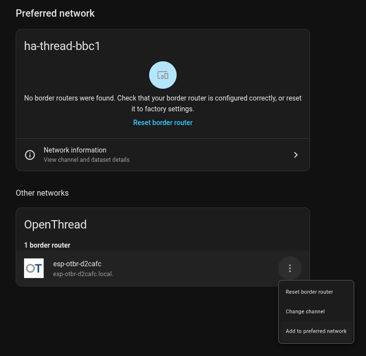
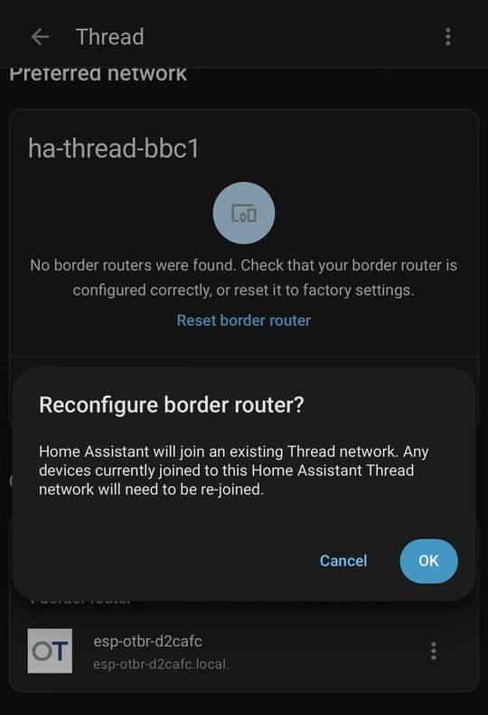
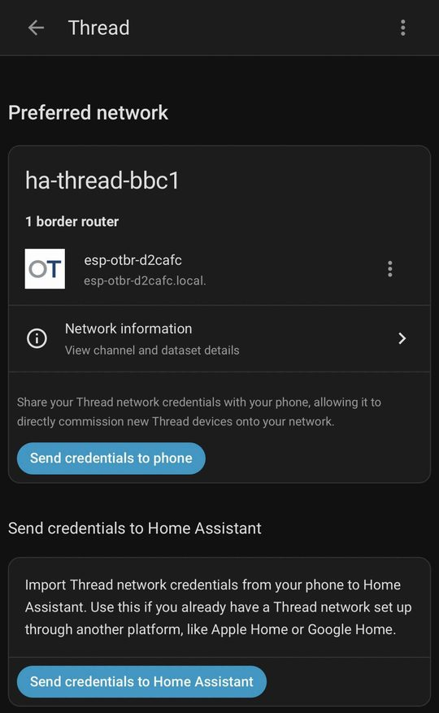

# Home Assistant

Home Assistant uses the board through its **OpenThread Border Router** integration, which talks to the board's Thread
REST API at `http://<board>`. The **Thread** integration then shows the board in the Thread panel, and Matter
devices on the board's Thread network reach Home Assistant through it.

## Before you start

- **Firmware v0.2.0 or later.** Older versions refuse a new network while Thread runs (409), so **Add to preferred
  network** fails.
- **The border router runs.** The Dashboard says "Border router running", not "Radio fault" (see
  [First install](first-install.md)).
- **A fixed address.** The integration stores the URL you type. Give the board a DHCP reservation, or a static address
  on the Ethernet page.
- **Home Assistant reaches the board.** Home Assistant must reach port 80 for the REST API.
- **The board and Home Assistant are on the same network.** Home Assistant finds border routers by mDNS: the board
  announces itself as `_meshcop._udp`. mDNS is multicast and does not cross routers or VLANs, so the board must be on
  the same network segment (subnet or VLAN) as Home Assistant, or a gateway must reflect mDNS between the two. Without
  that, the integration can still connect by URL, but the board is missing from the Thread panel, together with its ⋮
  menu (**Add to preferred network**, **Change channel**, **Reset border router**).
- **Split network mode:** use the `thread_bb` address. The `mgmt` interface refuses Thread REST changes with 403, and
  mDNS runs only on `thread_bb` (see [Networking](networking.md)).

## Add the integration

1. In Home Assistant, open **Settings > Devices & services > Add integration** and pick **OpenThread Border Router**.
2. Enter `http://<board>`, for example `http://192.168.1.117`.

What happens next depends on whether the board is already on a Thread network:

- **No network yet** (a new board, or after **Reset border router**): Home Assistant writes the dataset of its preferred
  network to the board and starts Thread. If Home Assistant has no preferred network yet, it creates a new one named
  `ha-thread-xxxx` instead. Either way, the board then appears under **Preferred network**.
- **Already on a network** (formed or joined in the board's web UI): Home Assistant leaves the network alone, and the
  board appears under **Other networks**. To move it onto the preferred network, see the next section.

Add every board as its own integration entry. Home Assistant identifies a board by its Border Agent ID, so adding the same
board a second time fails with "already configured".

## Move the board onto Home Assistant's preferred network

Open the Thread panel: **Settings > Devices & services > Thread > Configure**.

<table>
<tr>
<td width="40%"></td>
<td width="30%"></td>
<td width="30%"></td>
</tr>
<tr>
<td>1. The board is on another network: ⋮ > <b>Add to preferred network</b>.</td>
<td>2. Confirm with <b>OK</b>.</td>
<td>3. The board serves the preferred network.</td>
</tr>
</table>

1. Find the board under **Other networks**. The board is listed by its Home Assistant name, which follows its mDNS
   hostname, `esp-otbr-<last six hex digits of the MAC>`, unless you set one in the **mDNS** section of the Ethernet page (see
   [Networking](networking.md#mdns)).
2. Open its ⋮ menu (it offers **Reset border router**, **Change channel** and **Add to preferred network**), choose
   **Add to preferred network**, and confirm **Reconfigure border router?** with **OK**.
   Home Assistant writes the preferred network's dataset to the board. The board stops Thread, stores the new network,
   deletes any pending dataset of its old network, and starts Thread on the new one.
3. The board attaches within a minute or so. It moves to **Preferred network**, and the Dashboard shows the new network
   name.

Devices that were joined to the board's old network do not follow: they stay on the old network and have to be
re-joined.

Other actions in the panel:

- **Make preferred network** (in the ⋮ menu of a network card) keeps the board where it is and makes its network Home
  Assistant's preferred one instead. Devices already on the old preferred network stay there.
- **Change channel** (in the board's ⋮ menu) moves the board's network to another channel. Home Assistant writes a
  pending dataset with the new channel; the whole network switches when its delay runs out, after about 5 minutes. Some
  devices may need to be re-joined.
- **Reset border router** creates a fresh network. Home Assistant stops Thread, sends `DELETE /node`, which erases the
  board's Thread settings and restarts it (the Ethernet settings stay), then creates a new `ha-thread-xxxx` network on
  the board. Devices on the old network have to be re-joined.

## Phones and Matter

**Send credentials to phone** on the preferred network card gives the Home Assistant Companion app the network
credentials, so the phone can commission new Matter-over-Thread devices onto it. If the preferred network has several
border routers, Home Assistant marks one as **Used for Android + iOS credentials**; ⋮ > **Use router for Android + iOS
credentials** picks another.

## Several boards

Each board adds coverage. Put them all on the same network (**Add to preferred network** for each), and add each one
as its own integration entry. Copying the dataset by hand works too; see [More border routers on one network](thread-network.md#more-border-routers-on-one-network).

## Troubleshooting

- **"Failed to connect" when adding the integration:** open `http://<board>/` from the Home Assistant host's network.
  In split mode, use the `thread_bb` address. If the Dashboard is not "Border router running", the REST API answers 503.
- **The board is missing from the Thread panel:** the panel finds border routers by mDNS. Home Assistant has to be on
  the same network as the board (`thread_bb` in split mode), or behind a gateway that reflects mDNS.
- **"Failed to configure the border router" after Add to preferred network:** the board refused the dataset. During a
  packet capture it answers 409 (stop the capture), and in `STARTING` or `RADIO_FAULT` it answers 503. On firmware
  older than v0.2.0 it always refused; update the board.
- **The preferred network says "No border routers were found":** no border router that Home Assistant knows is on that
  network. Move a board onto it as above, or use **Make preferred network** for the network your board is on.
- **Removing the integration** leaves the board as it is: it keeps its network and keeps running.
