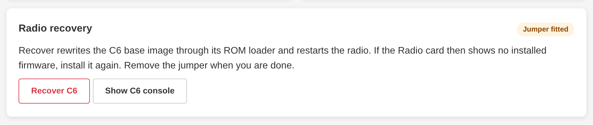

# Maintenance jumper

Three optional wires between the C6's pads H7 and the P4's header ([wiring](first-install.md#maintenance-jumper-wiring)).
With them fitted, the board can repair its own radio chip and show what the radio prints.

- **Repair at boot.** When the C6 doesn't answer, or a board update brings a new C6 base image, the board rewrites the
  C6's bootloader and updater by itself, once per boot.
- **Repair on demand.** **Recover radio** on the Firmware page's **Radio recovery** card does the same now. It takes a
  few seconds, up to two minutes over a poor wire.
- **Radio console.** **Show radio console** shows what the C6 prints, for debugging a radio that doesn't start.



A repair keeps the radio firmware when it is intact. If the Dashboard asks for it afterwards, upload `c6_rcp.bin`
([Updates](updates.md#radio-firmware)).

The board detects the jumper at boot. Without it, the **Radio recovery** card explains how to fit it, and the API calls
answer 412 `no_jumper`.

??? note "From the command line"
    ```
    curl -X POST http://<board>/device/radio/recover
    curl http://<board>/device/radio/log
    ```

    From a checkout: `make recover BOARD=<board>`.

How the repair works: [Internals](reference/internals.md#c6-base-image-and-rom-recovery).
