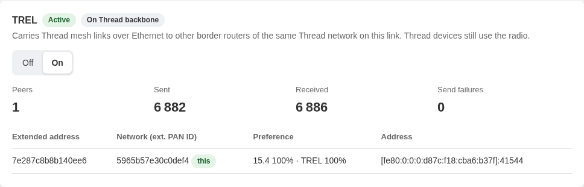

# Networking

Everything on **Device > Ethernet**: how the board sits on your network, its names, and Thread over Ethernet.

## Single port or split VLANs

- **Single port** (default): one network for everything, untagged, with DHCP. Right for most homes.
- **Split management and Thread:** two networks on the same cable, each untagged or on its own VLAN:
    - **Management** (`mgmt`): the web UI, the device API and metrics. Keep it on a private admin VLAN.
    - **Thread backbone** (`thread_bb`): where Thread meets your home network: Home Assistant's Thread REST API, mDNS,
      other border routers (TREL) and routing.

  Nothing passes between the two. A request on the wrong one is refused (403). mDNS runs only on the Thread backbone,
  so Home Assistant must be on that network. Your switch port must carry both VLANs (tagged) before you apply.

Change it on the Ethernet page: pick the setup, edit the interfaces (VLAN, DHCP or a static address), review the changes,
then apply. The board reboots into the new settings on trial.

<table>
<tr>
<td width="33%"></td>
<td width="33%"></td>
<td width="33%"></td>
</tr>
<tr>
<td>1. Pick the setup.</td>
<td>2. Edit the interfaces.</td>
<td>3. Review, then apply and reboot.</td>
</tr>
</table>

API: `PUT /device/network` ([HTTP API](api.md#device-api)), for example
`curl -X PUT http://<board>/device/network -d '{"mode":"split","mgmt":{"vlan":10,"ipv4":{"dhcp":true}},"thread_bb":{"vlan":20,"ipv4":{"dhcp":true}}}'`.

## Confirm-or-revert

A wrong VLAN or address could lock you out of the board, so a network change is only a trial at first. After the reboot,
every Device page shows a banner with a countdown: open the board at its new address and press **Keep new settings**
within 5 minutes. If nobody does, the board goes back to the previous settings by itself.

Keep the settings from the management side: the single port, or `mgmt` in split mode.

Locked out anyway? Connect USB-C and open the console at 115200 baud (`make monitor` from a checkout): `net show` prints
the settings, `net reset` goes back to a single untagged port with DHCP and reboots.

## mDNS and hostname

Two sections at the end of the Ethernet page (or `GET`/`PUT /device/names`, see [API](api.md)) set how the board is
named on the network. Each has its own Save; a save takes effect at once: no reboot, no trial, and the IPv4 lease is
kept.

### mDNS

| Setting | What it is | Default |
| --- | --- | --- |
| Hostname | the mDNS name, `<name>.local` | `esp-otbr-<last six hex digits of the MAC>` |
| Name in Home Assistant | the `_meshcop._udp` instance name Home Assistant's Thread panel shows | follows the hostname |
| Advertise the web UI | an `_http._tcp` record (port 80, `path=/`) so that network browsers find the web UI | off |

The hostname: letters, digits and hyphens, at most 63, not starting or ending with a hyphen; upper case is stored in
lower case; empty means the default. The Home Assistant name: at most 63 bytes of UTF-8, no control characters.

- **Conflicts:** when another device already uses the hostname, the board answers as `<name>-2.local`. The section
  shows a **Renamed** chip (**Announced** otherwise) and the name in use (`hostname_live`). Saving the same name again
  tries it again.

  

- **Moving to the new name:** a page opened at the old `.local` name moves to the new one after a save.
- **Split mode:** the hostname resolves on `thread_bb` only (mDNS runs there), while the web UI is on `mgmt`: open the
  page by the management address. For the same reason the web UI advert is not available in split mode (the setting is
  kept and applies again in single mode).

### Hostname

The DHCP client name is the name the board sends with its DHCP requests, which routers list. Default `esp-otbr`; letters, digits and hyphens, at most 32. The board asks for a lease
renewal on save, so the router learns the name without the address changing. With a static IPv4 address there is no
DHCP and the setting has no effect.

`net reset` touches neither section.

## TREL (Thread over Ethernet)

TREL (Thread Radio Encapsulation Link) carries Thread mesh links over Ethernet, next to the 15.4 radio: border routers of
the same Thread network on the same link become direct neighbours, so two radio islands joined only by the LAN form one
Thread network, and the mesh can route around weak radio hops. Thread devices themselves keep using the radio.

- On by default. It runs on the backbone interface: `thread_bb` in split mode, the Ethernet port otherwise. Peers are found
  with mDNS (`_trel._udp`) on that link, and only peers of the same Thread network (extended PAN ID) are used.
- It needs a partner: another border router of the same Thread network on that link that speaks TREL (OpenThread
  border routers built with TREL, such as ot-br-posix with `OTBR_TREL`, or another ESP Thread border router). To see
  which ones do: `avahi-browse -rt _trel._udp` (macOS: `dns-sd -B _trel._udp`). Without one, TREL does nothing.
- Switch it on the Ethernet page ("Thread over Ethernet": Off/On), or with `PUT /device/network` and only `trel` changed
  (send the active config with `trel` flipped). Such a change is applied at once and stored, without a trial or a
  reboot (`{"status":"applied"}`; `"saved"` when OpenThread was busy: it then applies at its next start). It is refused
  with 409 while a network trial runs. Changed together with interface settings, it goes through the trial with them.
- State, peers and counters: `trel` in `GET /device/status`, the card on the Ethernet page, `br_trel_*` in
  [metrics](metrics.md).
- TREL border routers of other Thread networks on the same link are found too, but never used. They are listed with
  their extended PAN ID and a red "other" chip and counted apart ("+ N peers of other networks", `peers_other`,
  `br_trel_peers_other`); "Peers" counts this network only.
- Preference: for a peer that is also a Thread neighbour, the card shows how much OpenThread trusts each path, radio
  and TREL, as a percentage. It sends over TREL while that is 86 % or more. The TREL figure turns red when it is lower
  than the radio's: the tunnel is losing. A broken tunnel shows as a falling TREL figure, not as a missing peer.
- Topology page: each TREL link of this board is a dashed purple curve through the "Home network · Ethernet" box with
  its TREL preference, red under the same rule; a link that runs over TREL only has no straight radio line. The device
  dialog and the "Connected via" column give both preferences and the radio OpenThread sends over. Links between
  other routers don't show whether they use TREL: Thread doesn't report it.
- In split mode UDP port 12390 (TREL) is dropped on `mgmt`.

