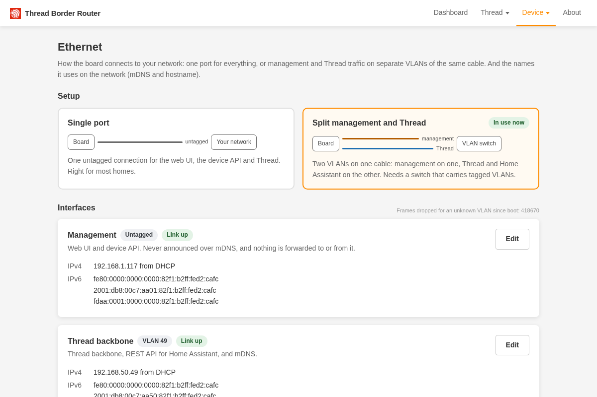
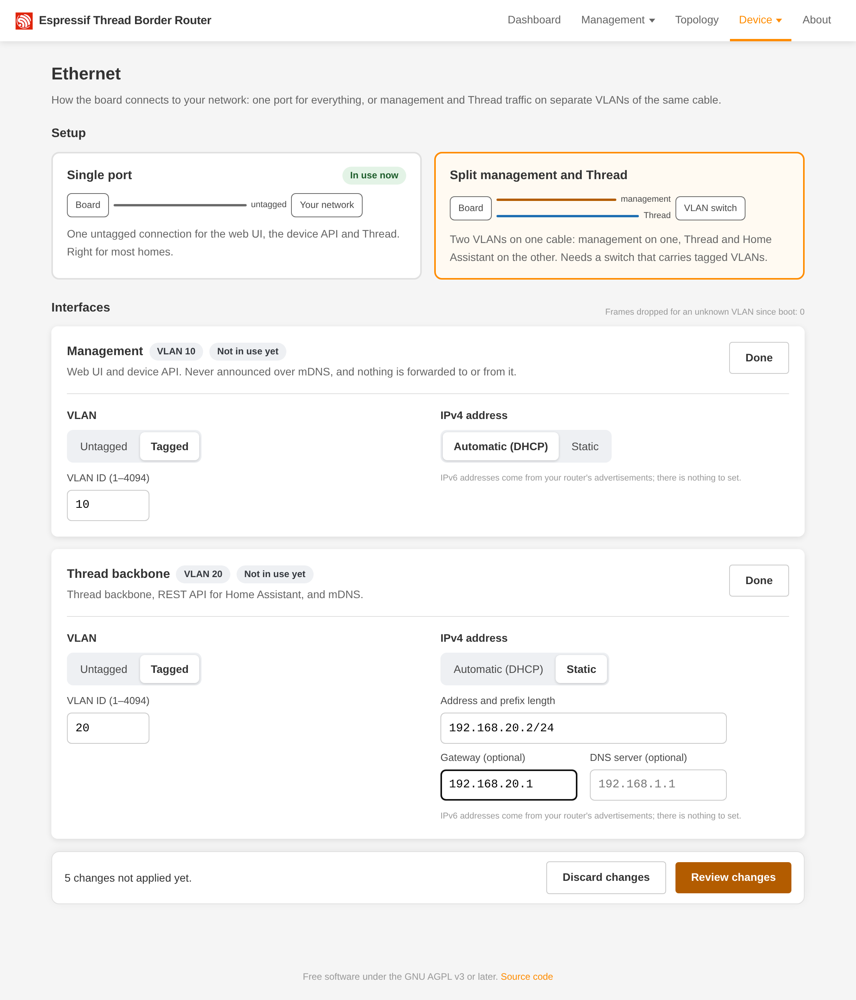
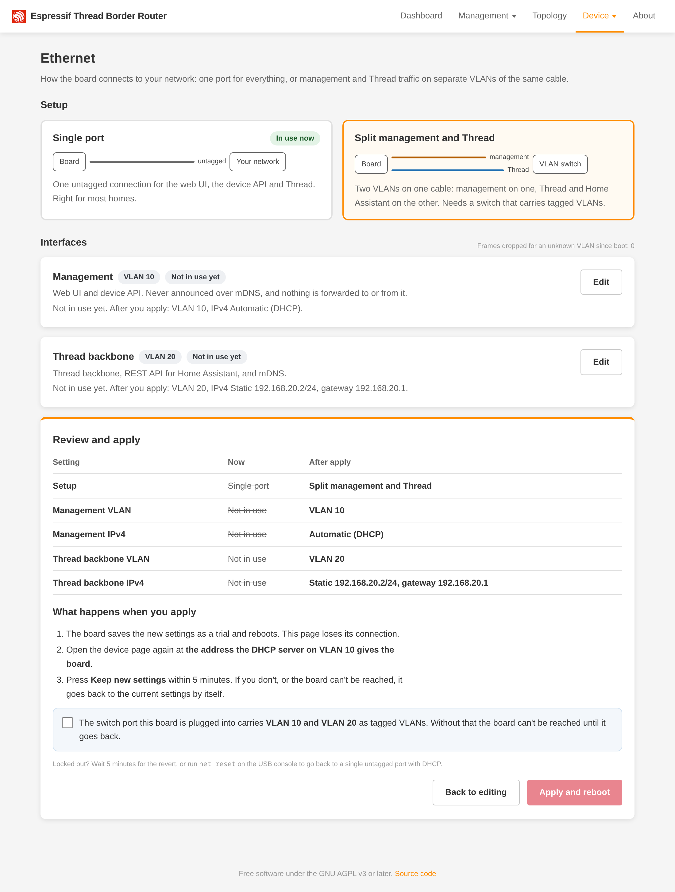
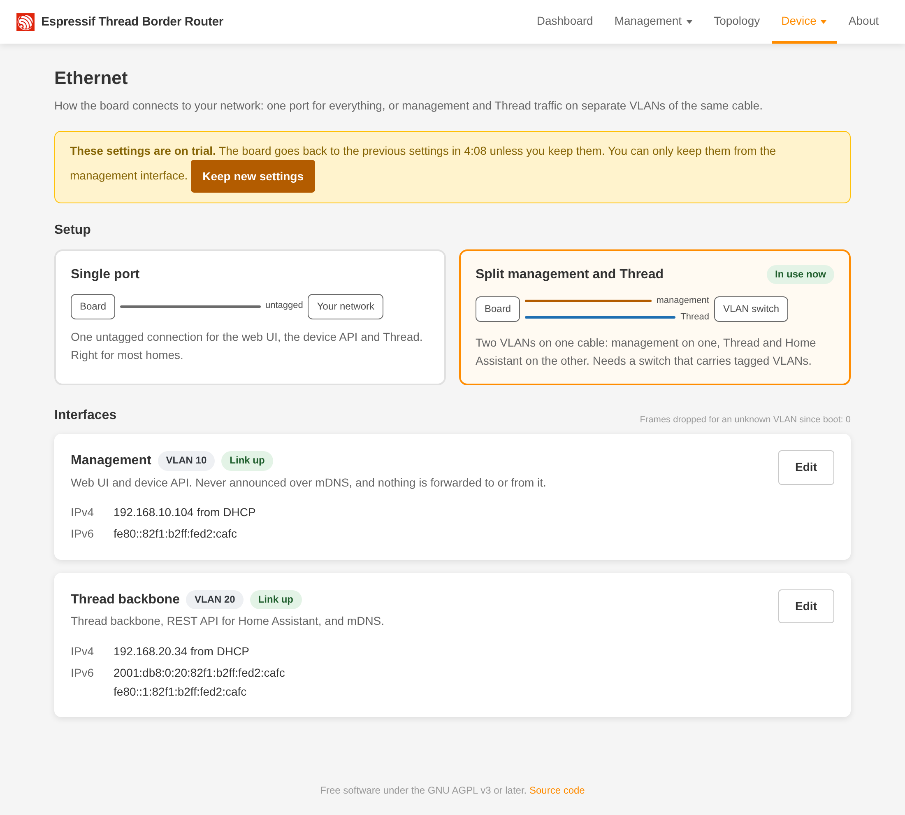
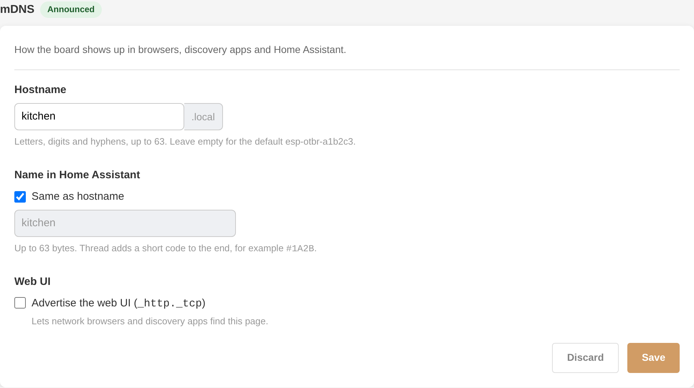
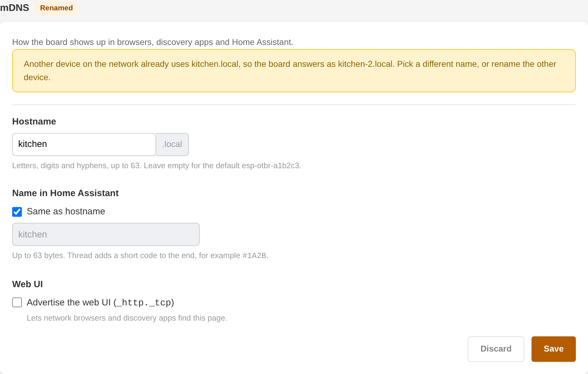
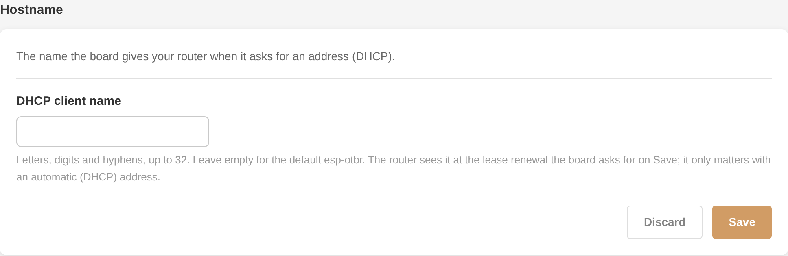

# Network modes, VLANs and prefix delegation

## Modes

The default is `single`: one untagged interface with DHCPv4 for everything. `split` separates two interfaces, `mgmt`
(web UI, `/device/*`, read-only `GET /node/*`) and `thread_bb` (the OpenThread backbone and the full Thread REST API
for Home Assistant), each untagged or on a VLAN ID (1..4094, distinct, at most one untagged). In split mode:

- Nothing is forwarded to or from `mgmt`. Replies leave by the interface the request came from.
- A request on the wrong interface is refused with 403 and the connection is closed.
- mDNS (hostname and every service, including `_meshcop._udp`) runs only on `thread_bb`; `mgmt` is never announced. A
  gateway that reflects mDNS between the VLANs may still show the `thread_bb` records on the `mgmt` VLAN; that is the reflector.

Change it on the Ethernet page (`http://<board>/ethernet.html`: pick the setup, edit the interfaces, review the
changes, then apply) or with `PUT /device/network`, for example:

```
curl -X PUT http://<board>/device/network -d '{"mode":"split","mgmt":{"vlan":10,"ipv4":{"dhcp":true}},"thread_bb":{"vlan":20,"ipv4":{"dhcp":true}}}'
```

Shape: `{"mode": "single"|"split", "single"|"mgmt"|"thread_bb": {"vlan": 0|1..4094, "ipv4": {"dhcp": true} | {"dhcp": false, "addr", "mask", "gw", "dns"}}}`.
`vlan: 0` is untagged. The switch port must carry the VLANs before you apply.

<table>
<tr>
<td width="33%"></td>
<td width="33%"></td>
<td width="33%"></td>
</tr>
<tr>
<td>1. Pick the setup.</td>
<td>2. Edit the interfaces.</td>
<td>3. Review, then apply and reboot.</td>
</tr>
</table>

## Confirm-or-revert

The change is stored as a trial and the board reboots into it. You then have 5 minutes to call
`POST /device/network/confirm` (or press **Keep new settings** on any device page) from the management side, that is the `single`
interface or `mgmt` of the trial config. If you do not (or the board resets first), the trial is dropped and the board
reboots into the previous config. If the board is unreachable after a network change: wait 5 minutes, or use the console.



Console (`make monitor`, USB-C port, 115200 baud, any build): `net show` prints the active config, trial and interfaces;
`net reset` restores `single`, untagged, DHCPv4 and reboots.

## mDNS and hostname

Two sections at the end of the Ethernet page (or `GET`/`PUT /device/names`, see [API](api.md)) set how the board is
named on the network. Each has its own Save; a save takes effect at once: no reboot, no trial, and the IPv4 lease is
kept.

### mDNS



| Setting | What it is | Default |
| --- | --- | --- |
| Hostname | the mDNS name, `<name>.local` | `esp-otbr-<last six hex digits of the MAC>` |
| Name in Home Assistant | the `_meshcop._udp` instance name Home Assistant's Thread panel shows | follows the hostname |
| Advertise the web UI | an `_http._tcp` record (port 80, `path=/`) so that network browsers find the web UI | off |

The hostname: letters, digits and hyphens, at most 63, not starting or ending with a hyphen; upper case is stored in
lower case; empty means the default. The Home Assistant name: at most 63 bytes of UTF-8, no control characters.

- **Conflicts:** when another device already uses the hostname, the board answers as `<name>-2.local`. The section
  shows a **Renamed** chip (**Announced** otherwise) and the name in use (`hostname_live`). Saving the same name again
  tries it again.

  

- **Moving to the new name:** a page opened at the old `.local` name moves to the new one after a save.
- **Split mode:** the hostname resolves on `thread_bb` only (mDNS runs there), while the web UI is on `mgmt`: open the
  page by the management address. For the same reason the web UI advert is not available in split mode (the setting is
  kept and applies again in single mode).

### Hostname



The DHCP client name is the name the board sends with its DHCP requests, which routers list. Default `esp-otbr`
(lwIP's `espressif` before); letters, digits and hyphens, at most 32 (the `esp_netif` limit). The board asks for a lease
renewal on save, so the router learns the name without the address changing. With a static IPv4 address there is no
DHCP and the setting has no effect.

`net reset` touches neither section.

## DHCPv6 prefix delegation

On with the route method `pd` (the default), off with every other method (see
[Routing to the mesh](#routing-to-the-mesh)); `pd.state` then reads `disabled`. `pd.state` and `pd.prefix` in
`/device/status` are `null` when OpenThread was busy and its state could not be read (ask again). `pd.state` mirrors
OpenThread's DHCPv6-PD client (`disabled`, `stopped`, `running`). The client is `running` while it solicits, so with no
delegating router `pd.state` is `running` and `pd.prefix` is `null`; the local ULA prefix is then the OMR prefix. With a
delegation, Thread devices get global addresses from it: this makes them reachable from the Internet unless your
router's IPv6 firewall blocks it. A delegating router must offer lifetimes above 300 s (OpenThread raises T1/T2 to at
least 300 s).

## Routing to the mesh

Hosts on other networks reach a Thread device only if the core router has a route to the mesh's OMR prefix. The
board's Router Advertisements carry it as a Route Information Option, which hosts on the backbone may use, but routers
ignore it. Without DHCPv6 prefix delegation (no IPv6 from the ISP, or address space from your own ASN), tell the
router with RIPng or BGP, and pick the OMR prefix yourself.

Settings: the Routing page (`http://<board>/routing.html`, "Device" menu), `PUT /device/routing` (shape in
[the API doc](api.md#routing)) or, read only, the console command `routing show`. Changes apply live: no reboot and no
confirm-or-revert, since they cannot cut off management access. They are stored in NVS and survive reboot and OTA.

### OMR prefix

- `auto` (default): today's behavior. The delegated prefix while the method is `pd` and a prefix is delegated, else the
  self-generated ULA.
- `custom`: one /64 you route to the board, for example a GUA /64 from your own space. It overrides PD. The board sets
  it as OpenThread's OMR prefix with preference medium. It must be a /64 with the host bits zero, not link-local
  (`fe80::/10`), not multicast, and not a prefix that is on-link on the backbone.

"Announce self-generated ULA" (`announce_ula`):

- with `auto`: decides only whether RIPng or BGP announces the ULA;
- with `custom`: the board also publishes the ULA on the mesh as a SLAAC on-mesh prefix with preference low, so Thread
  devices get an address from both prefixes and the custom one stays the favored OMR prefix. A custom prefix equal to
  the ULA is accepted; the box then adds nothing.

The ULA is the one OpenThread generates and keeps across reboots. Prefixes added on the Addresses page
(`/add_prefix`) are left alone and never announced.

### Route method

Exactly one of:

| Method | What the router learns |
| --- | --- |
| `pd` (default) | nothing from the board: the delegating router knows the prefix it delegated |
| `ripng` | the announced prefixes over RIPng |
| `bgp` | the announced prefixes over BGP, to up to 2 peers |
| `off` | nothing |

Announced (`ripng` and `bgp`): the custom prefix when set, and the ULA when the box is ticked, each only while it is in
the mesh's Network Data (another border router's favored prefix can push it out). Switching method stops the old one
first: BGP sends a Cease (6/2) on every session, RIPng sends every prefix with metric 16 once.

While the border router is not running (packet capture, radio fault, Thread disabled or detached) every route is
withdrawn at once, and announced again when it runs. A BGP session that goes down, or a router that stops talking
RIPng, changes nothing on the mesh: the prefixes stay published.

Everything runs on the backbone interface: the single interface, or `thread_bb` in split mode. Connections and
packets on `mgmt` are refused or ignored. There is no authentication (lwIP has no TCP-MD5, RIPng has none): limit what
the router accepts from the board, as in the examples below.

### BGP

An announce-only speaker: it sends the announced prefixes and never installs what it receives. Routes from a peer are
counted (`received_dropped`) and dropped, read through one 4096-byte buffer per session.

- Peers: at most 2, each an IPv6 address (global, or link-local on the backbone) and an ASN. The same ASN as the board
  is iBGP, a different one eBGP. 4-octet ASNs work; 23456 (AS_TRANS) is not allowed.
- The peer must advertise the 4-octet ASN and the IPv6 unicast capabilities; one that does not is refused with
  NOTIFICATION 2/7 (FRR and BIRD advertise both).
- Router ID: the board's IPv4 address on the backbone, else the configured `router_id`. With neither, sessions do not
  start and `status.bgp.blocked` is `"no router id"`. Without a link-local address on the backbone it is
  `"no link-local address"`.
- TCP port 179 over IPv6, both directions: the board connects out and accepts connections from its peers (RFC 4271
  collision handling). Retries back off from 5 s to 120 s.
- Hold time: 0 or 3..65535 s, default 90. Keepalives every third of the negotiated hold time.
- Attributes: ORIGIN IGP; AS_PATH empty on iBGP, the board's ASN on eBGP; LOCAL_PREF 100 on iBGP.
- Next-hop: the board's global address on the backbone (a GUA before a ULA) and its link-local, the 32-byte form of
  RFC 2545. With no global address, the link-local alone in a 16-byte next-hop, which RFC 2545 does not cover. FRR,
  which the UDM Pro runs, and BIRD are expected to accept it on a directly connected session; both are still to be
  confirmed on the test rig (`p4/pytest/test_routing.py`, `TestBgpLinkLocal`).
- Changes: changing the OMR prefix or the ULA box only sends UPDATEs. Removing a peer or changing its ASN closes that
  session with Cease 6/3. Changing the local ASN, the hold time or the router ID in use restarts every session with
  Cease 6/6.

The board, iBGP with a UDM Pro at `2001:db8:42::1`:

```
curl -X PUT http://<board>/device/routing -d '{"method":"bgp","omr":{"mode":"custom","prefix":"2001:db8:42:100::/64"},"announce_ula":true,"bgp":{"local_asn":4200000001,"router_id":null,"hold_time":90,"peers":[{"address":"2001:db8:42::1","asn":4200000001}]}}'
```

The router (FRR), with the board at `2001:db8:42::15`: accept only the board's /64s, at most 2 of them (more drops the
session, which FRR brings back up after 5 minutes instead of waiting for an operator), and send it nothing.

```
ipv6 prefix-list thread-br-in seq 5 permit 2001:db8:42:100::/64
ipv6 prefix-list thread-br-in seq 10 permit fd98:2656:4740:1::/64
!
route-map thread-br-out deny 10
!
router bgp 4200000001
 neighbor 2001:db8:42::15 remote-as 4200000001
 neighbor 2001:db8:42::15 description thread-border-router
 address-family ipv6 unicast
  neighbor 2001:db8:42::15 activate
  neighbor 2001:db8:42::15 prefix-list thread-br-in in
  neighbor 2001:db8:42::15 maximum-prefix 2 restart 5
  neighbor 2001:db8:42::15 route-map thread-br-out out
 exit-address-family
```

Take the ULA from `status.ula_prefix` of `GET /device/routing`. For eBGP give the board its own ASN and use it in
`remote-as`. A link-local peer is `neighbor fe80::... interface <backbone if>`.

### RIPng

RFC 2080 with fixed values; there are no RIPng settings.

- Responses go to `ff02::9` port 521 from the board's link-local address, hop limit 255. Each prefix is a /64 entry with
  route tag 0 and metric 1, so the router sees metric 2 with the board's link-local as next-hop.
- A full update every 30 s plus a random 0..5 s. A change goes out as a triggered update with only the changed entries,
  at most one every 5 s. A removed prefix is sent with metric 16 in the triggered update and in the next 4 regular
  updates.
- Switching away from `ripng`, or the border router stopping, sends every prefix with metric 16 at once, so the router
  drops the routes at once. If the board dies, the router drops them 180 s after the last update (the RFC 2080
  timeout).
- Requests are answered unicast to the sender's address and port. Responses from routers are counted
  (`responses_dropped`) and dropped.

The router (FRR `ripngd`), with the backbone on `eth0`:

```
ipv6 prefix-list thread-br-in seq 5 permit 2001:db8:42:100::/64
ipv6 prefix-list thread-br-in seq 10 permit fd98:2656:4740:1::/64
ipv6 prefix-list nothing seq 5 deny any
!
router ripng
 network eth0
 distribute-list prefix thread-br-in in eth0
 distribute-list prefix nothing out eth0
```

The router (BIRD 2), with the backbone on `eth0` and the usual `protocol device` and `protocol kernel` exporting to the
kernel:

```
protocol rip ng thread_br {
  ipv6 {
    import where net ~ [ 2001:db8:42:100::/64, fd98:2656:4740:1::/64 ];
    export none;
  };
  interface "eth0" { };
}
```

### Status

- `GET /device/routing`, `status`: the OMR prefix in use, the ULA, what is announced, and per BGP session the state,
  uptime, last error and routes dropped, or the RIPng counters.
- `/device/status`, `routing`: method, OMR mode, number of announced prefixes, BGP sessions up and configured.
- `/metrics`: the `br_routing_*`, `br_bgp_*` and `br_ripng_*` series ([metrics](metrics.md#routing-metrics)).
- The Routing page shows the same and refreshes every 5 s.
