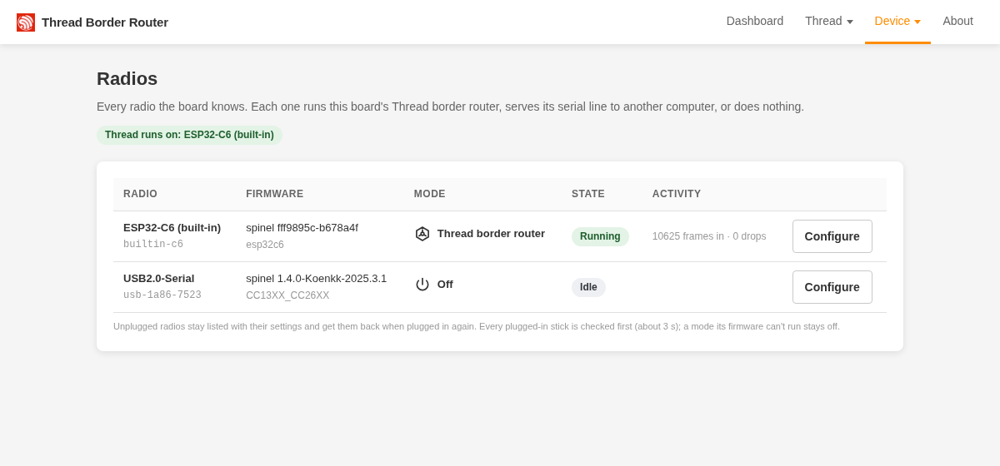
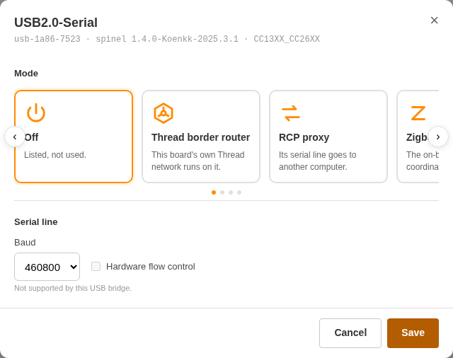
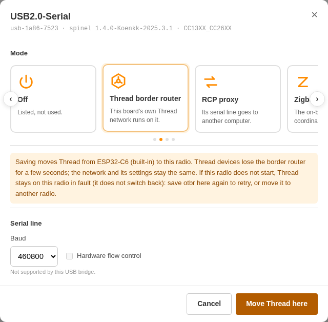

# Radios and USB dongles

The board has one radio built in, the ESP32-C6, and a USB-A port for a second one: a USB radio dongle such as the
ZigStar OllyZig. Each radio runs in one **mode** that you pick on the **Radios** page:

| Mode | What the radio does |
| --- | --- |
| **Thread border router** (`otbr`) | Runs this board's Thread network. Needs OpenThread [RCP](glossary.md) firmware. One radio at a time. |
| **Zigbee (Ziggurat)** (`ziggurat`, experimental) | Runs the board's own Zigbee coordinator for Home Assistant's ZHA, see [Zigbee coordinator](zigbee.md). One radio at a time; switching into or out of it reboots the board. |
| **RCP proxy** (`rcp-proxy`) | Hands the radio's serial line to another computer over the network, see [RCP proxy](#rcp-proxy). Works with any dongle firmware. |
| **Off** (`off`) | Listed, not used. The C6 is held in reset. |

Out of the box the C6 runs the Thread border router and a new dongle is off. Without a dongle nothing changes: you
don't need this page.

Thread and the Zigbee coordinator can run at the same time, each on its own radio (for example Thread on the built-in
ESP32-C6 and Zigbee on a USB dongle, or the other way round). A radio runs one mode at a time. Starting or stopping
Zigbee reboots the board, and Thread on the other radio restarts with it. Setting Zigbee on the radio that runs Thread
stops Thread until you set another radio to Thread. An RCP proxy can run beside either.

## Supported dongles

- USB bridges: CP210x, CH34x (CH340) and plain CDC-ACM. Other bridges (FTDI, for example) are listed but can't be used.
- One dongle at a time.
- Tested with the ZigStar OllyZig (CH340 bridge, TI CC2652 with OpenThread RCP firmware).

When you plug a dongle in, the board checks its firmware (about 3 s) and shows it in the **Firmware** column:

| The dongle runs | Shown as | Modes it can run |
| --- | --- | --- |
| OpenThread RCP | `spinel`, with its version | Thread border router, Zigbee, RCP proxy, Off |
| Ziggurat firmware | `ziggurat` | RCP proxy, Off |
| Z-Stack (TI) | `znp` | RCP proxy, Off |
| EmberZNet / EZSP (Silicon Labs) | `ezsp` | RCP proxy, Off |
| Anything else | `unknown` | RCP proxy, Off |

`unknown` is not an error: the dongle may run something else, or need a serial speed the board doesn't try. A mode its
firmware can't run is greyed out, with the reason. If you reflash a dongle elsewhere, unplug and plug it in again so
the board checks it again.

## The Radios page

Open **Device > Radios** (`http://<board>/radios.html`).

- The **table** lists every radio the board knows, with its firmware, mode, state and traffic. An unplugged dongle stays
  listed, greyed out, with its settings, and gets them back when you plug it in again. The heading says which radio
  Thread runs on.
- **Configure** opens a radio's settings: the mode cards, the proxy settings and, for a dongle, the serial speed
  (**Baud**) and **Hardware flow control** (CP210x only). **Save** stores the settings, then switches the mode.
- **Forget this radio** (in the dialog of an unplugged dongle) removes it and its settings.

## USB/IP

With the [USB/IP server](usbip.md) on, the USB-A port is exported to the network and no radio runs on it. The USB
channels are listed as `unavailable` with the reason "USB is exported over USB/IP" (the Radios page links to the
USB/IP page); `PUT /device/channels/{id}` with a `mode` is refused with 409 `usbip_enabled`. Baud, flow control and
proxy settings and "Forget this radio" still work. Their stored modes apply again when USB/IP is turned off. USB/IP
cannot be turned on while a USB channel stores `otbr` or `ziggurat` (409 `usb_channel_in_use`). `GET /device/channels`
has a top-level `usbip` flag.

## Moving Thread to another radio

To move the Thread border router from the C6 to a dongle (or back): open **Configure** on the radio that should run it,
pick **Thread border router** and press **Move Thread here**.

- The board first checks that the new radio answers as an OpenThread RCP. If it doesn't, nothing changes.
- Thread then stops on the old radio and starts on the new one, with the same network: no reboot, no re-pairing. Thread
  devices lose this border router for a few seconds; other border routers keep the network up meanwhile.
- The move takes up to about a minute. The page follows it and shows the result. The old radio is set to **Off**.
- If Thread doesn't start on the new radio, it stays bound there and the board shows a radio fault: try again, or move
  Thread back.
- When the new radio runs Zigbee, the move is different: there is no check first, and saving reboots the board. After
  the reboot Thread runs on the new radio, Zigbee is stopped and the old radio is **Off**. Thread devices lose the
  border router for about 20 s.

The same way, picking **Thread border router** on a radio while no radio runs it starts Thread there, and picking another
mode on the Thread radio stops Thread.

### Unplugging the Thread dongle

- The board does not reboot. Its Thread status becomes **No radio**, the Thread pages and Home Assistant's integration
  get "no radio in OTBR mode", and everything else keeps working.
- Plug the dongle back in: Thread starts on it again with the same network.
- The board does not fall back to the C6 by itself. To use the C6, move Thread there.
- A dongle that stays plugged in but stops answering is reopened and reset; after three failed tries the board shows a
  radio fault. Unplug and replug it, or save its mode again.

## RCP proxy

In **RCP proxy** mode another computer uses the board's radio over the network, as if the radio were plugged into it.
Use it for:

- **Zigbee2MQTT** or another Zigbee host with a dongle running Z-Stack or EZSP firmware.
- An **OpenThread border router on Linux** (`otbr-agent`) that drives the C6 or a dongle with OpenThread RCP firmware.

Settings in the Configure dialog:

| Setting | Choices |
| --- | --- |
| **Direction** | **Listen** (default): the other computer connects to the board, on **Local port** (default 6638). **Connect**: the board dials out to **Host** and **Remote port**. |
| **Network adapter** | **TCP** (default) or **UDP**. |
| **Framing** (UDP only) | **HDLC frames** (default, one frame per datagram) or **Raw** (for testing only: loss corrupts the stream). |

One computer at a time: while one is connected, others are turned away. Ports 80 and 179 can't be used, and two radios
can't listen on the same port.

Host settings, with the board listening on TCP port 6638 (the `otbr-agent` one is tested on the board; the others are
the hosts' usual settings for a network-attached radio):

- **Zigbee2MQTT:** `serial: { port: "tcp://<board>:6638", adapter: "zstack" }` (or `ember` for EZSP firmware).
- **ZHA with a Z-Stack or EZSP dongle:** serial device path `socket://<board>:6638`.
- **otbr-agent:** `socat -d pty,raw,echo=0,link=/tmp/ttyRCP tcp:<board>:6638`, then
  `otbr-agent 'spinel+hdlc+uart:///tmp/ttyRCP?uart-baudrate=460800'`.

The C6 speaks to the board over SPI, not a serial line; in proxy mode the board turns its frames into the HDLC byte
stream a serial RCP sends, and resets the C6 when a new computer connects, so the host sees a fresh radio.

!!! warning "No login"
    The proxy has no password and no encryption: anyone who can reach the port can drive the radio. Serve it only on a
    network you trust. The board refuses connections that start like a web request, so a web page in a browser can't
    use it.

If the board can't listen (the port is taken) or can't reach the host, the radio shows **Backoff** with the reason, and
the board keeps retrying.

## Updating the C6's radio firmware

A radio firmware upload on the Firmware page ([Updates](updates.md#radio-firmware)) restarts whatever runs on the C6:
Thread, Zigbee or the proxy. The upload is refused while a proxy client is connected to the C6: disconnect it first.
A dongle's firmware is updated with its own tools, not through the board.

## More

- The API: `GET /device/channels`, `PUT /device/channels/{id}` ([HTTP API](api.md#radio-channels)). The API calls a
  radio a **channel**: `builtin-c6` for the C6, `usb-<vid>-<pid>[-<serial>]` for a dongle.
- How detection, moves, unplugs and the proxy work in detail: [Internals](reference/internals.md#radios).
