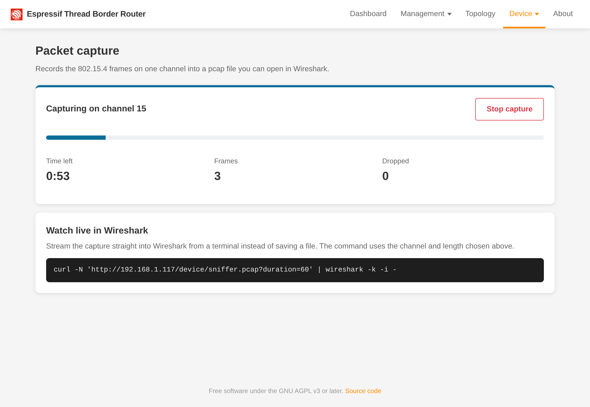

# Packet capture

The board can record the 802.15.4 radio traffic of one Thread or Zigbee channel into a file for
[Wireshark](https://www.wireshark.org/), to see what devices actually send.

!!! warning "Thread stops while it records"
    The radio can only listen or take part, not both. During a capture this board leaves the Thread network; other
    border routers keep it up, and the board rejoins by itself when the capture ends.

## On the Packet capture page

**Device > Packet capture**:

1. **Channel:** 11 to 26. Leave it empty for the Thread network's channel.
2. **Length:** 30 s, 1 min, 10 min or 1 h. You can stop early.
3. **Start capture.** Your browser saves `sniffer.pcap` as the frames arrive. Open it in Wireshark.



**Dropped** counts frames lost because the computer read too slowly.

## Live in Wireshark

**Watch live in Wireshark** on the page shows a command that streams the capture straight into Wireshark from a
terminal:

```
curl -N "http://<board>/device/sniffer.pcap?channel=15" | wireshark -k -i -
```

`duration` (seconds, default 600, at most 3600) sets the length; `curl -X DELETE http://<board>/device/sniffer` stops
it.

## Good to know

- A capture needs a radio in Thread border router mode, running.
- The frames carry the signal strength (RSSI) and link quality (LQI) of each frame, but no checksum (FCS): Wireshark's
  checksum warnings don't apply.
- A capture never survives a reboot: the board always starts as a border router.
- Thread frames are encrypted. To read them in Wireshark, add the network key under **Preferences > Protocols >
  IEEE 802.15.4 > Decryption keys** with the key hash **Thread hash** (Home Assistant shows the network key; the board
  has it in its dataset).
