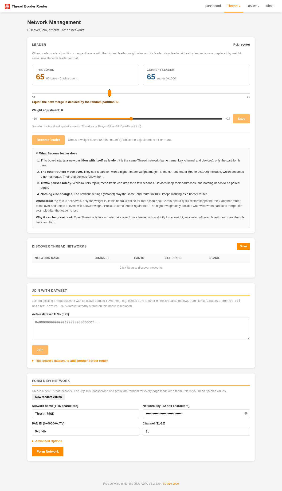
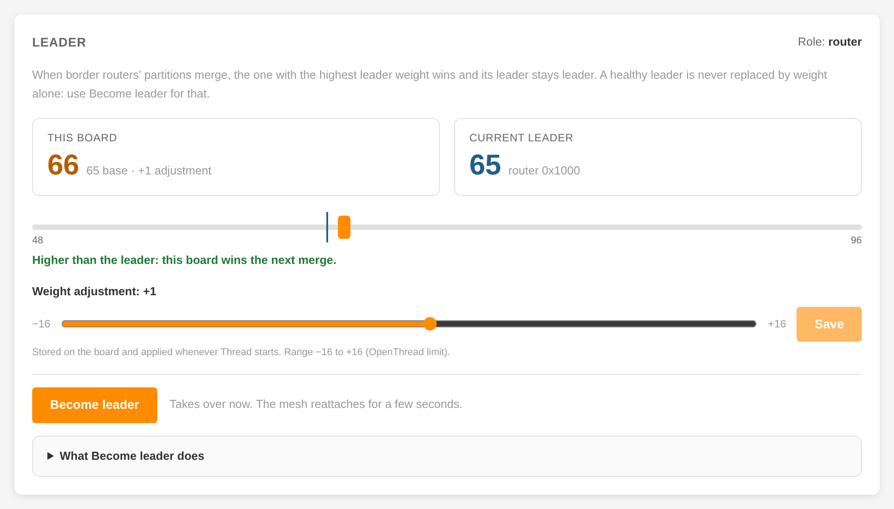
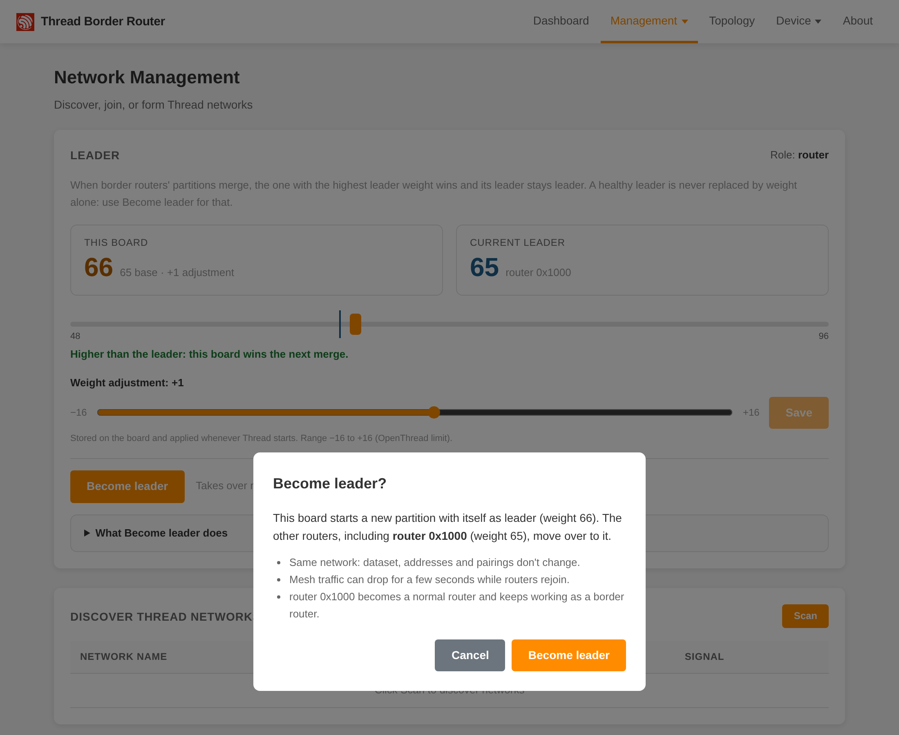

# Your Thread network

The board never forms or joins a Thread network by itself: it waits until you give it one. A Thread network is defined
by its **dataset** (name, Thread channel, network key and a few IDs; see the [Glossary](glossary.md)); every border router and device on the network shares it.
The board stores the dataset and uses it again after every reboot.

Three ways to give the board a network:

- **Home Assistant** (recommended with Home Assistant): add the board to the OpenThread Border Router integration, and
  Home Assistant writes its preferred network to the board. See [Home Assistant](home-assistant.md).
- **The Network page** (**Thread > Network**): form a new network, join one nearby, or paste a dataset.
- **The REST API**, for scripts.

## On the Network page



- **Discover Thread Networks:** press **Scan** to list nearby networks, then **Join** on one. Joining this way asks
  for the network key (or a joiner PSKd); with another border router's network, the dataset is easier.
- **Join with Dataset:** paste the network's active dataset as hex, copied from another of these boards (below), from
  Home Assistant or from `ot-ctl dataset active -x`. A dataset already on the board is replaced.
- **Form New Network:** create a new network. The key and IDs are random; keep them unless you need specific values,
  and pick a name and a Thread channel (11 to 26).

Within about half a minute the Dashboard's Thread section shows the network, with this board as **leader** when it is
alone on it.

## More border routers on one network

Several boards (or other border routers) on the same network each add coverage, and the others keep the network up when
one goes down. Give every board the same dataset:

- With Home Assistant: add each board as its own integration entry and use **Add to preferred network** on each one
  ([Home Assistant](home-assistant.md#several-boards)).
- By hand: on the first board's Network page copy the hex under **This board's dataset**; on the new board paste it
  into **Join with Dataset**. The dataset holds the network key: anyone with it can join the network.

Boards of one network on the same Ethernet link also connect over Ethernet with TREL, so separate radio areas become
one mesh ([Networking](networking.md#trel-thread-over-ethernet)).

## Choosing the leader

Every Thread network has one **leader**, a router that keeps the network's shared data. Any router can do it; if the
leader goes away another takes over within about two minutes. You only need this section if you want a particular board
to be the leader, for example the one with the best position or power supply.

Two boards that join the same network don't trade the leader role by themselves: the board that formed the network
stays leader. To make another board the leader:

1. On that board's Network page, find the **Leader** card. Move the **weight adjustment** slider above the current
   leader's weight (for example +1) and press **Save**. The adjustment is stored and changes no role yet.
2. Press **Become leader** and confirm. The board takes over; mesh traffic can pause for a few seconds; nothing needs to
   be paired again.





Only the weight is stored, not the role. If the board is offline for more than about two minutes, another router
becomes leader and keeps the role; press **Become leader** again when the board is back.

## With the REST API

Copy the dataset from one board to another:

```
curl -H 'Accept: text/plain' http://<first-board>/node/dataset/active > dataset.tlv
curl -X PUT -H 'Content-Type: text/plain' --data-binary @dataset.tlv http://<new-board>/node/dataset/active
curl -X PUT -H 'Content-Type: application/json' -d '"enable"' http://<new-board>/node/state
```

The last call is only needed when the new board had no network before (`GET /node/state` says `disabled`).

Form a network from Python with `python-otbr-api` (`pip install python-otbr-api aiohttp`), as Home Assistant does:

```
import asyncio, aiohttp, python_otbr_api as api

async def main():
    async with aiohttp.ClientSession() as session:
        otbr = api.OTBR("http://<board>", session)
        await otbr.create_active_dataset(api.models.ActiveDataSet(network_name="MyThread", channel=15))
        await otbr.set_enabled(True)

asyncio.run(main())
```

`GET /node/state` answers `leader`, `router`, `child`, `detached` or `disabled`. The leader weight is set with
`PUT /device/thread` ([HTTP API](api.md#device-api)).
