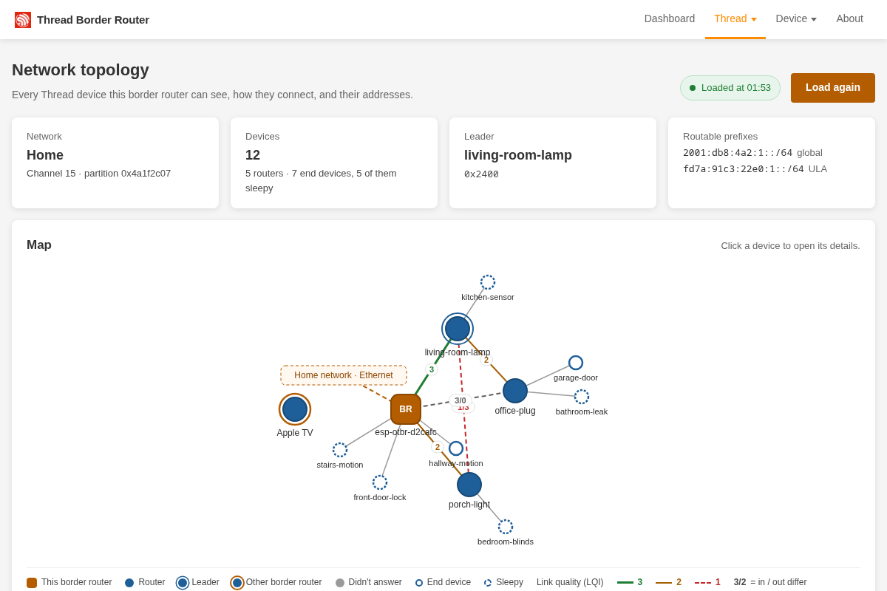
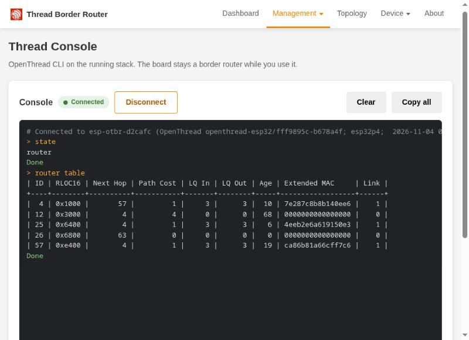

# Topology and console

Two pages under **Thread** help you see what is on your Thread network.

## Topology

**Thread > Topology** draws the mesh: every router, every device attached to a router, how they connect and their
addresses.

- Press **Load topology**. The board asks every router about its neighbours, children and addresses; this takes a few
  seconds (up to a few minutes for battery devices that sleep) and adds a little delay to Thread traffic while it runs,
  so the page only does it when you ask. **Show last result** shows the previous scan, kept in this browser.
- **Map:** routers and their links, coloured by link quality; this board, the leader and other border routers are
  marked. A dashed purple curve is a link that runs over Ethernet ([TREL](networking.md#trel-thread-over-ethernet)).
  Click a device to open its details.
- **Devices:** a table with search and filters: type, what it connects through, link quality and routable addresses.
- **Device details:** its neighbours or children, its addresses, what the device says it is (vendor, model, firmware,
  when it answers), the services it registered (Matter, HomeKit, ESPHome and others) and a ping. **Rename** gives it a
  name kept in this browser only.

The scan's API is `POST /device/topology` / `GET /device/topology` ([HTTP API](api.md#device-api)).

## Thread console

**Thread > Console** runs OpenThread CLI commands on the board, in the browser: `state`, `router table`,
`ping <address>`, `dns browse ...`. It helps when you debug a mesh and have no second Thread device at hand. The board
stays a border router while you use it.

- It is off by default: press **Turn the console on** on the page. One session at a time; a new one takes over.
- The page asks before commands that change or reset the network (`factoryreset`, `reset`, `thread stop`,
  `ifconfig down`, `dataset` changes).
- Commands run only while the border router runs.

The console has no login, like the rest of the board. Its WebSocket and messages are in
[HTTP API](api.md#thread-console).
