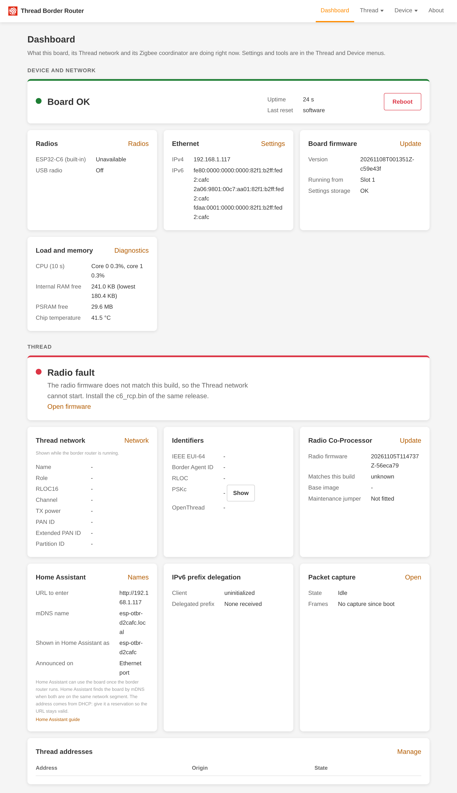

# Troubleshooting and limitations

## Fault reasons

`GET /device/status` (`make status BOARD=<board>`) shows `mode` and `fault_reason`. In `RADIO_FAULT` the Thread API
answers 503; `/device/*`, the device pages and OTA keep working.

The Dashboard shows the fault in red, with what to do and a link to the page that fixes it:

| `fault_reason` | Meaning and fix |
| --- | --- |
| `no rcp firmware` | The C6 has no valid RCP image (new board, erased slots). Upload `c6_rcp.bin`. Not retried automatically. |
| `esp-hosted firmware` | The C6 still runs its factory ESP-Hosted firmware and no jumper was seen. Upload `c6_installer.bin` of the same release (its C6 base version must match), then `c6_rcp.bin` ([First install](first-install.md), Path 1). OpenThread is not started. |
| `rcp incompatible` | OpenThread rejected the RCP, or it did not answer its reset. Upload the `c6_rcp.bin` of the same release. |
| `storage unavailable` | NVS did not initialise (for example no free pages), `storage_ok` is `false`. The board booted degraded instead of boot-looping: HTTP, OTA and `/device/*` work, OpenThread does not start. NVS is never erased automatically because it holds the Thread credentials. Update to a firmware that fixes it, or erase NVS by hand (`esptool --chip esp32p4 -p /dev/ttyACM0 erase-region 0x9000 0x10000`; the Thread network has to be set up again) and reboot. |
| `rom recovery failed` | The updater was silent and the jumper recovery failed. Check the jumper wires and `GET /device/radio/log`; try `make recover`; without a jumper use Path 3 of [First install](first-install.md) (USB-UART on H7). |
| `resetting the RCP failed`, `radio boot timed out`, `radio restart failed`, `OpenThread main loop ended` | Radio did not come up. The board retries (at most three automatic recoveries per 10 minutes), then waits: reboot, or upload firmware. Check the antenna and the C6 console log. |

## Other problems

- Board unreachable after a network change: wait 5 minutes for the revert, or use the console `net reset` (`make monitor`).
- No IP address: check the cable and the switch port (VLAN setup), `net show` on the console.
- `GET /api/node` / `/api/devices` show `state` `disabled` (name `OpenThread`, rloc16 `0xfffe`) although `GET /node` says
  `leader`: upstream esp-thread-br builds that collection entry once and never refreshes it (see
  `p4/components/PATCHES.md`, "Known upstream behaviour"). Use `/node`, `/node/state` or `/node/dataset/active` (what Home
  Assistant uses) for the live state.
- Thread REST answers 503 `radio not available`: see `mode` above; 409 `sniffer active`: a capture is running
  (`DELETE /device/sniffer`).
- The board boots in `RADIO_FAULT` after an on-board test: see [Development](development.md#testing) (`c6_hold 0`).
- The board rebooted by itself and the console showed `supervisor: the OpenThread lock is stuck` or `... the HTTP
  server task is stuck`: a deadlock was caught (the OpenThread lock not free for 2 minutes, or the HTTP server task not
  answering for 2 minutes). The core dump is in the `coredump` partition (`idf.py -C p4 coredump-info`); please report it.
- Recovery from a bad P4 flash: reflash over USB (`make erase flash`). See [First install](first-install.md#recovery-procedures)
  for the C6.

## Known limitations and non-goals

- No authentication or TLS anywhere: anybody on the network can reconfigure the board, read the Thread dataset with
  `GET /node/dataset/active` (also from the `mgmt` VLAN: read-only `GET /node/*` is served there by design) or update its
  firmware. Put it on a trusted network. `https://` URLs are not supported for downloads.
- DHCPv6-PD makes Thread devices globally addressable; rely on the upstream router's firewall.
- Mesh topology requests slow down pings through the border router while they run, because of the Diagnostic Get
  traffic. Measured with `p4/pytest/test_latency.py` (one Thread peer, a ping every 100 ms, the requests repeated
  back to back; 2026-11-03):
  - **The page's scan** (`POST /device/topology`) adds about 105–117 ms to the 99th-percentile round trip, and no ping
    is lost. A scan is one discover, then two unicast mesh-diagnostics queries per router (its child table and its
    children's addresses), then one query per full-device child that reported no address. Only one scan runs at a time.
  - **The old `/topology`** (a multicast diagnostic get, no longer used by the page) adds about 77 ms, and 13 of 1000
    pings were lost.
  - **For comparison,** `/node` requests add about 2 ms.

  The page only scans when someone clicks Load, so in normal use this is a short, occasional delay.
- Flash writes (OTA) use XIP from PSRAM so traffic keeps flowing, but the P4 reboots after an update.
- The `-dirty` flag of the app version stamp is as of the last configure (see [Building](building.md#versions)); a new commit
  refreshes the stamp.
- Untested on hardware: the USB-UART first install ([First install](first-install.md), Path 3, esptool over H7).
- Untested on hardware: recovery of a truly blank C6 (bootloader, partition table and otadata erased).
- The no-wires first install ([First install](first-install.md), Path 1) ran on the board against an ESP-Hosted 0.0.27
  stand-in, not yet against an untouched factory C6; nor the case where the installer lands in the slot it must overwrite
  (a factory C6 updated before) and moves itself first.
- A mDNS reflector between the two VLANs is tolerated, but a host that claims the board's mDNS name with different addresses
  can rename it (standard mDNS behaviour).
- Radio firmware updates interrupt the border router for a few seconds; seamless updates are not implemented.
- Not verified on hardware: the `br_core` give-up path after repeated radio failures, and the fall-back to default network
  config when the stored config cannot be applied (host-tested only).
