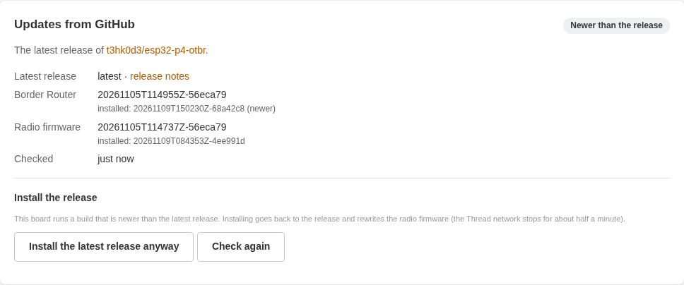

# Updates

The board runs two pieces of firmware, both updated over the network on **Device > Firmware**:

- **Border Router**: the P4's firmware and the web UI, one file per board and chip ([firmware target](glossary.md)), named
  `<board_id>_<chip_id>.ota`. An update reboots the board.
- **Radio Co-Processor**: the C6's radio firmware, `c6_rcp.bin`. An update restarts the radio, not the board.

Keep both from the same release.


## Update from GitHub

The **Updates from GitHub** card checks the [latest release](https://github.com/t3hk0d3/esp32-p4-otbr/releases/latest)
when you open the page (at most once an hour; **Check again** checks now) and shows what it would install.



Press **Install &lt;release&gt; and reboot**. The board downloads the release, installs the board firmware, then the radio firmware when
it differs, and reboots once. It takes a minute or two.

- The board never updates by itself: an update interrupts Thread, so you choose when.
- The check needs internet access and DNS on the board.
- If the radio firmware fails to install after the board firmware, the board still reboots into the new firmware and the
  page says so. The card then offers **Install the radio firmware of &lt;release&gt;**: it installs only the radio
  firmware, without a reboot.
- A board that runs a newer development build is offered **Install the latest release anyway** to go back to the
  release.
- On a C6 that still runs its factory firmware (radio fault **esp-hosted firmware**), the page first installs the
  release's `c6_installer.bin` through that firmware, then goes on as above. This takes about 5 minutes more. Don't
  power off the board meanwhile: a power cut while the installer writes leaves a C6 that only the
  [maintenance jumper or a USB-UART adapter](first-install.md#2-put-the-radio-firmware-on-the-c6) can repair. If the
  board firmware is updated in the same go and the installer does not fit the running firmware, the board firmware is
  installed alone: press **Install** again after the reboot.

API: `GET /device/update` shows the check, `POST /device/update` installs ([HTTP API](api.md#device-api)).

## Board firmware from a file

On the **Border Router** card, choose the file the card names from a release (or give its download address) and press
**Install and reboot**. It is `<board_id>_<chip_id>.ota`, for example `ESP32-P4-WIFI6-POE-ETH_ESP32-P4-rev1.3.ota`. A
board on older firmware has no such name on its card and takes `otbr.bundle`. A file for another chip is refused with
`invalid_bundle` and the running firmware stays. The board writes the new firmware next to the running one and reboots into it about a second
after the reply.

The new firmware is kept once it has run for 60 s with its web server up. If it crashes or restarts before that,
the board starts the previous firmware again by itself. A new firmware that hangs without restarting stays until you
power-cycle the board, which then starts the previous one.

??? note "From the command line"
    ```
    curl --data-binary @<board_id>_<chip_id>.ota http://<board>/device/ota
    curl -X POST -d '{"url": "https://host/<board_id>_<chip_id>.ota"}' http://<board>/device/ota/url
    ```

    `GET /device/update` names the file in `bundle`. From a checkout: `make build`, then `make ota BOARD=<board>`
    packs that build and uploads it. For a board that isn't the default target, pass `BOARD_ID=<board_id> CHIP_ID=<chip_id>`
    to both.

## Radio firmware

On the **Radio Co-Processor** card, choose `c6_rcp.bin` (or give its download address) and press **Install radio
firmware**.

- Whatever runs on the C6 stops for a few seconds and starts again on the new firmware: Thread, Zigbee or the
  [RCP proxy](radios.md#rcp-proxy). The Thread network keeps running on other border routers meanwhile; devices whose
  parent is this board lose it for that time. The stored network stays.
- A failed upload (cable pulled, power cut) leaves the old firmware in place; upload again.
- The page answers once the radio runs again, or says why it didn't.
- It is refused during a packet capture, while Thread starts, and while a proxy client is connected to the C6.

??? note "From the command line"
    ```
    curl --data-binary @c6_rcp.bin http://<board>/device/radio/firmware
    curl -X POST "http://<board>/device/radio/firmware?from_url=https://host/c6_rcp.bin"
    ```

    From a checkout: `make radio BOARD=<board>`. Download addresses follow redirects, so a GitHub release asset URL
    works as it is.

## Which versions fit together

The radio firmware must match the board firmware's OpenThread version. If it doesn't, the Dashboard shows the radio fault
**rcp incompatible**: install `c6_rcp.bin` from the same release as the board firmware. The installed versions are on the
Firmware page and in `GET /device/status` (`make status BOARD=<board>` from a checkout).

## Trust

Releases are not signed. The board downloads them from GitHub over HTTPS, checked against the certificates built into
its firmware. Anyone on your network can also upload firmware to the board, since it has no login.

How the check compares versions and in which order it installs: [Internals](reference/internals.md#self-update).
