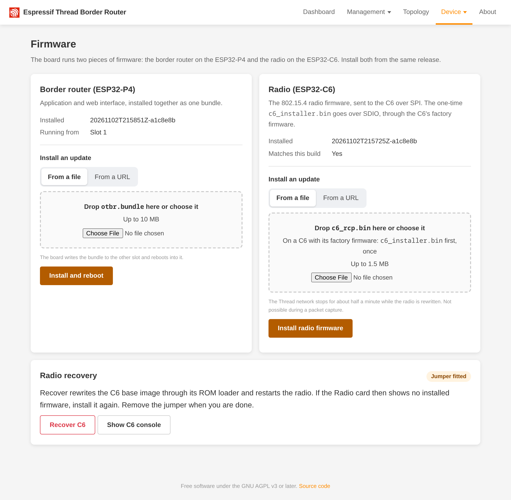

# Updates

The P4 firmware (app and web UI) and the C6 radio firmware are updated separately, both over the network.

## Update from GitHub

The board can fetch and install a release of <https://github.com/t3hk0d3/esp32-p4-otbr> itself: the "Updates" card on the
Firmware page, or the API (`GET`/`POST /device/update`, see [HTTP API](api.md)).

What is checked, and when. The board reads `versions.txt` of the latest release (`.../releases/latest/download/versions.txt`,
about 120 bytes, no GitHub API). It lists the release tag (`release:`, releases after v0.4.0; until the first of them the check uses the `latest/download` links), the P4 app version and the
`c6_rcp` version. Nothing happens in the background: there is no periodic check and no automatic install, because an update
restarts a border router. The Firmware page starts a check when it opens and the last check is older than one hour or never
ran; "Check again" and `GET /device/update?check=true` start one on request. The result is cached until the next check or
reboot, and a failed check keeps the last good result. A check needs internet access and DNS on the board.

How versions are compared. The first 16 characters of a version (`YYYYMMDDTHHMMSSZ`) are the build time, and versions are
ordered by it. The release is `newer`, `older` (the board runs a dev build made after the release), `same` (equal time and
git hash; `-dirty` is ignored) or `unknown` (anything else, or a version that cannot be read). `newer` and `unknown` offer an
install. The radio firmware is compared by equality: it is installed when the release's `c6_rcp` differs from `rcp.installed`
or the installed version is unknown. Every release is built with new stamps, so an update usually pushes the radio firmware
too.

The install order. The install runs its own fresh check first (the cached result is never used), then downloads every file
from `.../releases/download/<tag>/`, so the bundle and the radio firmware come from the release that was checked, even if a
newer one appears meanwhile (a release without a tag line uses `latest/download/`). Then:

1. The bundle (`otbr.bundle`) is installed as with `POST /device/ota/url`. It is the large download and the likeliest to
   fail; a failure here changes nothing.
2. The radio firmware (`c6_rcp.bin`) is pushed as with `POST /device/radio/firmware?from_url=`. Thread is stopped for this
   push and the network keeps running on other routers, as described under "C6 radio firmware".
3. One reboot, about a second after the reply.

If the push fails after the bundle was committed, the board still reboots into the new P4 and the reply says
`"rcp": "failed"` with the reason in `detail`. Run the update again: the app is then `same`, so only the radio firmware is
pushed. An update of the radio firmware alone has no reboot, and a failed push leaves the old firmware running. When the
radio firmware is to be installed, the install answers 409 `busy` before touching anything while the board is sniffing or
still starting. It also answers 409 `busy` while an OTA, a radio push, ROM recovery or a check runs.

A dev build and `force`. Without `force`, the app is installed only when the release is `newer` or `unknown`, and the radio
firmware only when it differs. When the board runs a build newer than the release (`older`), or is up to date, and the radio
firmware is equal, the plain `POST /device/update` answers 409 `up_to_date`. `POST /device/update?force=1` installs the release anyway (the app, and the
radio firmware when the release has one), which is how a dev build goes back to a release. The Firmware page offers this as
"Install <tag> anyway" for a newer dev build, never as the plain install.

Trust. Bundles and radio images are not signed. Trust rests on TLS to GitHub: the connection is verified against the
certificate bundle built into the firmware (see below), and the repository is fixed at build time. Anyone who can obtain a
certificate that chains to one of those roots for `github.com` can serve the board a bundle. Signed bundles are not
implemented.

Test builds (`OTBR_TEST_BUILD`) add the console command `update_source <base>`, which points the check and the install at
another releases base: `<base>/latest/download/versions.txt` and `<base>/download/<tag>/<file>`, for example a local HTTP
server (`p4/pytest/test_self_update.py` does this). An empty argument restores GitHub. The release link on the page then
points to the same base, and the page shows it only for an `https://` base.

## P4 and web UI (OTA)

```
make ota BOARD=<board>      # builds dist/otbr.bundle from the current build and uploads it
```

or upload `otbr.bundle` from a release on the Firmware page (`http://<board>/firmware.html`, "Border router"), or
`curl --data-binary @otbr.bundle http://<board>/device/ota`. The bundle holds the web image and the app image; both are
written to the inactive pair, the web image is read back and checked against its SHA-256, and only then the boot partition
is switched. The reply is 200 and the board reboots about a second later. A new app that does not run for 60 s with the
HTTP server listening is rolled back by the bootloader. `tools/make_bundle.py --help` shows how to inspect a bundle.



To let the board fetch the bundle itself: `curl -X POST -d '{"url": "http://host/otbr.bundle"}' http://<board>/device/ota/url`.
Both `http://` and `https://` URLs work. An `https://` server is verified against the certificate bundle built into the firmware (the common root set, which covers GitHub and its download host); certificate expiry dates are not checked, because mbedTLS is built without time checks (`MBEDTLS_HAVE_TIME_DATE` is off). Any other scheme gives 400 `invalid_request`.

Updates are accepted in every mode (also in `RADIO_FAULT` and while sniffing). One update or radio push at a time.

## C6 radio firmware

The RCP firmware is not part of the P4 image and never stored on the P4. Update it independently:

```
make radio BOARD=<board>    # uploads c6_rcp/build/c6_rcp.bin
```

or "Radio" on the Firmware page, or with a `c6_rcp.bin` from a release:

```
curl --data-binary @c6_rcp.bin http://<board>/device/radio/firmware
curl -X POST "http://<board>/device/radio/firmware?from_url=http://host/c6_rcp.bin"
```

`from_url` (and `/device/ota/url`) follow HTTP redirects, so a GitHub release asset URL works as it is.

The reply is `{"installed": "<version>"}`.

What happens: the border router stops (Thread and OpenThread are shut down), the P4 resets the C6 into its updater,
streams the image to it frame by frame (nothing is buffered on the P4), the C6 checks it and switches its boot slot
only when the transfer is complete, then the C6 resets and OpenThread starts again. Expect a few seconds of outage;
the Thread network keeps running on the other routers meanwhile, and an end device whose parent is the border router
loses its parent for that time. The Thread dataset stays stored and is used again. A failed upload (cable pulled, C6 reset
mid-transfer) leaves the previous firmware in place and the border router restarts with it; upload again. With `from_url`
the P4 retries the whole transfer up to three times.

## Versions and compatibility

`GET /device/status` (`make status BOARD=<board>`) shows `rcp.installed` (version string reported by the C6 updater: a
non-empty string, `""` when the C6 has no valid RCP firmware, `null` if the probe failed) and `rcp.compatible`. The
version is only informative: nothing is compared or ordered. Compatibility is decided by OpenThread itself when it
starts: it rejects an RCP that does not match the OpenThread build of the P4 (spinel/RCP API version), and the board goes
to `RADIO_FAULT` with the reason `rcp incompatible` (`rcp.compatible` false). The cure is the same as for a missing
firmware: upload a matching `c6_rcp.bin` (from the same release as the P4 bundle, or one the release notes say is
compatible). A C6 without any RCP firmware gives `RADIO_FAULT` with `no rcp firmware`.

A P4 update runs the automatic ROM recovery only when the content-addressed base image version changed (see
[Maintenance jumper](maintenance-jumper.md)); the RCP firmware survives it.
