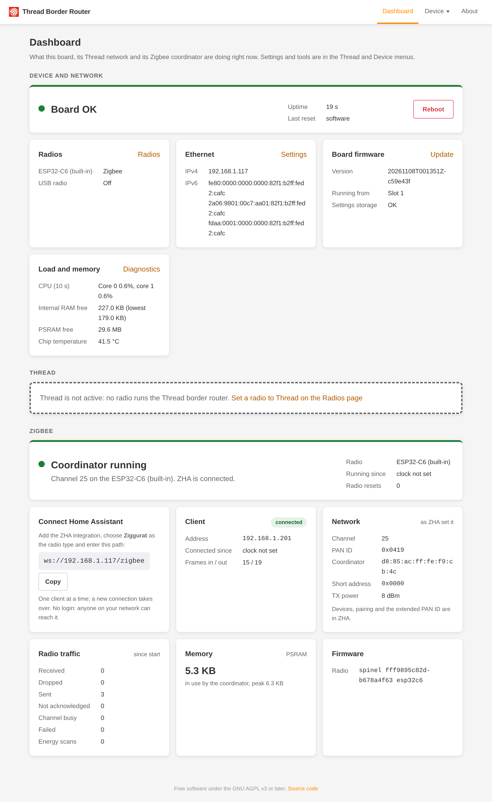

# Web UI tour

Open `http://<board>/` in a browser: the board's IP address, or `http://esp-otbr-<last six hex digits of the
MAC>.local/` where your computer resolves `.local` names. In [split mode](networking.md) use the management address:
the `.local` name points at the Thread backbone, which doesn't serve the web UI. There is no login.

The menu has three parts:

| Menu | Page | What it is for | Guide |
| --- | --- | --- | --- |
| | **Dashboard** | Status of the board, Thread and Zigbee at a glance, with a link to whatever needs attention | below |
| **Thread** | **Network** | Form a network, join one, copy its dataset, choose the leader | [Your Thread network](thread-network.md) |
| | **Topology** | Map of the mesh: routers, devices, links, services | [Topology and console](topology.md) |
| | **Routing** | How other networks reach the mesh: prefix delegation, BGP, RIPng | [Routing to the mesh](routing.md) |
| | **Commissioner**, **Addresses**, **Tools** | Upstream OpenThread pages: commission a device by joiner credentials, add on-mesh prefixes, ping | |
| | **Console** | The board's OpenThread command line in the browser | [Topology and console](topology.md#thread-console) |
| **Device** | **Radios** | What each radio runs: Thread, Zigbee, RCP proxy or off | [Radios](radios.md) |
| | **Ethernet** | Single or split (VLAN) setup, addresses, names, time server, Thread over Ethernet | [Networking](networking.md) |
| | **Firmware** | Updates from GitHub, uploads, radio recovery | [Updates](updates.md) |
| | **Diagnostics** | CPU, memory, tasks | [Monitoring](diagnostics.md) |
| | **Packet capture** | Record 802.15.4 traffic for Wireshark | [Packet capture](sniffer.md) |
| | **About** | Versions and licences | |

The Thread menu is hidden while no radio runs the Thread border router (for example while the board is a Zigbee
coordinator).

## Dashboard

The Dashboard has three sections:

- **Device and network:** the board's status, uptime, last reset and a Reboot button; the two radios and their modes;
  Ethernet addresses; board firmware; CPU load, memory and chip temperature.
- **Thread:** while the border router runs, the network (name, Thread channel, PAN ID), this board's role, the radio
  firmware, the address to enter in Home Assistant, prefix delegation, packet capture and the board's Thread addresses.
- **Zigbee:** while a radio runs the Zigbee coordinator, its state, the `ws://` address for ZHA with a Copy button, the
  connected client and the network ZHA formed. See [Zigbee coordinator](zigbee.md).

A section whose stack is not running says so in one line and links the Radios page. A problem shows in red, with what
to do and a link to the page that fixes it (see [Troubleshooting](troubleshooting.md)).

## Network settings on trial

After you change the Ethernet setup, the board reboots into the new settings on trial. Every Device page then shows a
banner with a countdown and **Keep new settings**. If nobody presses it within 5 minutes, the board goes back to the
old settings. See [Networking](networking.md#confirm-or-revert).

## Device pages keep working

The Device pages use only the board's own `/device/` API. They work while the radio is in fault, during a packet capture
and with no Thread network at all, so you can always reach Firmware and Radios to fix things.
