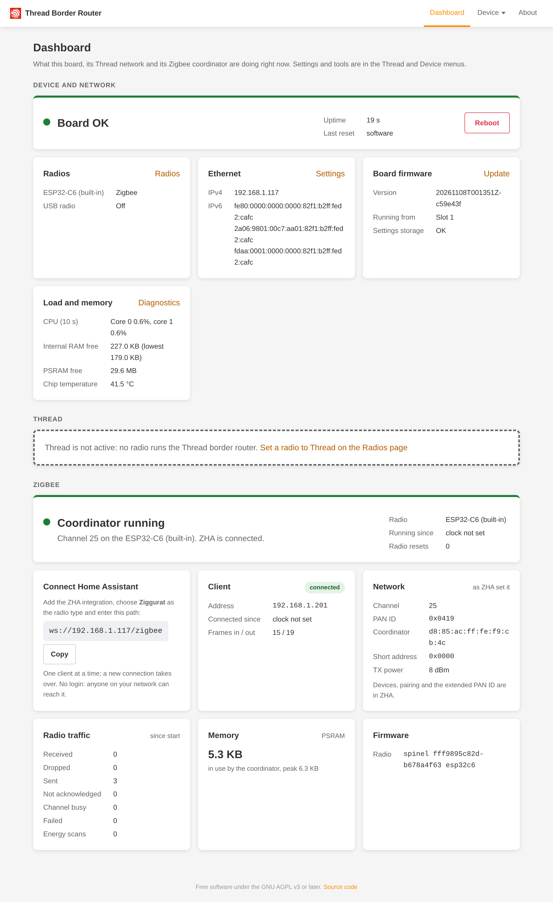

# Zigbee coordinator (experimental)

!!! warning "Experimental"
    Zigbee mode is new and not yet tested much on real boards. Expect rough edges, and don't rely on it for a network
    you can't afford to lose. Keep ZHA's backups.

In Zigbee mode the board is a Zigbee coordinator for Home Assistant's ZHA integration, instead of a Thread border
router. The Zigbee stack (Ziggurat) runs on the board itself; ZHA talks to it over the network. The radio is the C6 or a
USB dongle with OpenThread RCP firmware: the same radio hardware serves both Thread and Zigbee. Ethernet, the web UI,
updates and the diagnostics work as before.

## Choosing it

On the **Radios** page set the mode of the radio to **Zigbee** (`ziggurat`), or `PUT /device/channels/<id>` with
`{"mode": "ziggurat"}` (the C6 is `builtin-c6`, a USB dongle `usb-<vid>-<pid>[-<serial>]`). Changing into or out of Zigbee
mode reboots the board. When the board is back, the Dashboard's **Zigbee** section shows the coordinator running.

A radio in Zigbee mode is not a Thread radio. If the C6 is the Zigbee radio, Thread does not run on the board (the
Thread menu entries are hidden and the Thread REST API does not serve a network); Home Assistant's OpenThread Border
Router integration then has nothing to talk to. Setting the C6 back to `otbr` reboots into Thread with the dataset
the board had stored.

## Connecting Home Assistant

1. Add the ZHA integration and choose to set it up manually.
2. Radio type: **Ziggurat**. Serial device path: `ws://<board>/zigbee` (the Dashboard's Zigbee section shows the
   exact address and a Copy button).
3. ZHA forms a new network (the stack keeps no state of its own: ZHA's database holds the network settings) or
   restores one from a backup.

Other zigpy-based software works the same way if it has the Ziggurat adapter. Zigbee2MQTT is not zigpy-based and has no
Ziggurat adapter: give it a USB dongle with Z-Stack or EZSP firmware in `rcp-proxy` mode instead (see
[RCP proxy](radios.md#rcp-proxy)).

One client at a time. A second client that connects takes the connection over: the first one is dropped. The Dashboard
shows the current client and the last one.

!!! warning "No login"
    Like the rest of the board's HTTP API, the WebSocket needs no password. Anyone who can reach the board can control
    your Zigbee network. Keep the board off networks you do not trust. The WebSocket follows the same per-interface
    policy as the device API (`/device/`): on an interface where the device API is not allowed, the upgrade is refused
    with 403.

## The Dashboard's Zigbee section

While a radio runs Zigbee, the Dashboard's Zigbee section shows the state (starting, running, no radio, incompatible),
the address for ZHA with a Copy button, the connected or last client, the network ZHA formed (Zigbee channel, PAN ID,
transmit power), radio traffic, the memory the stack uses and the radio firmware. API: `GET /device/zigbee`.

## Radio resets and loss

- **Reset.** When the radio resets (the C6 restarts, a dongle is reopened), the board sets the radio up again by
  itself (it replays the radio configuration) and the client stays connected. ZHA sees no event. A transmit that was
  in flight fails, as a lost frame does. `counters.rcp_resets` counts them.
- **Radio gone.** When the radio disappears (a dongle is unplugged, the C6 is held in reset) the state is
  `no_radio` with a reason. A firmware push or ROM recovery of the C6 pauses it the same way, with the reason "radio
  reinit: firmware push" ("radio reinit: ROM recovery"; before the first start, "radio reinit: boot steps"). The board does not reboot, the stack keeps running and the client stays
  connected; transmits fail meanwhile. When the radio returns, the board replays the radio configuration and the
  state is `running` again. The push answers only then: 502 `restart_failed` "the image is installed, but Zigbee did
  not start on it: <reason>" when Zigbee does not run on the new firmware.
- **Firmware that does not fit.** A radio whose firmware cannot run the stack shows `incompatible` with the reason.

## Limits

- No hybrid: Thread and the Zigbee coordinator never run at once on the board, even on separate radios (409
  `hybrid_not_supported`). A radio in RCP proxy mode can run beside either.
- One Zigbee radio at a time; a second radio in Zigbee mode is refused.
- No settings on the board: the network (Zigbee channel, PAN ID, keys) is ZHA's. Resetting the board forgets the network, so
  keep ZHA's backups.
- Mode changes into and out of Zigbee reboot the board.
- Slow pairing of router devices (mains-powered bulbs, plugs, switches): a device that joins as a router often fails
  the key exchange, leaves and joins again every few seconds, so pairing takes 20 to 60 s and sometimes fails. End
  devices pair normally. Tracked upstream in
  [zigpy/ziggurat#88](https://github.com/zigpy/ziggurat/issues/88). Keep
  permit-join open and retry the pairing if it fails.
